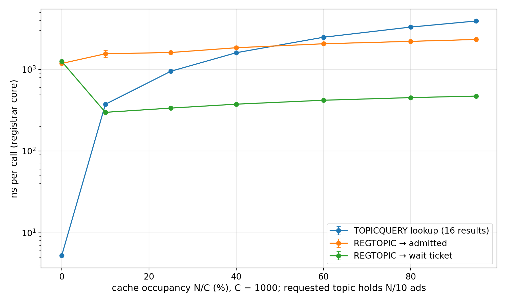
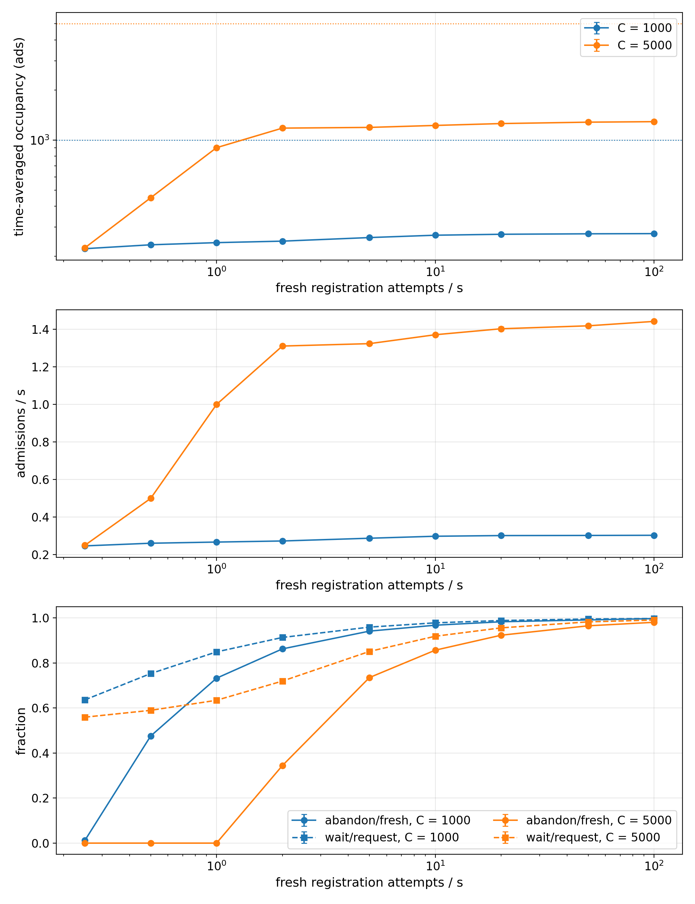
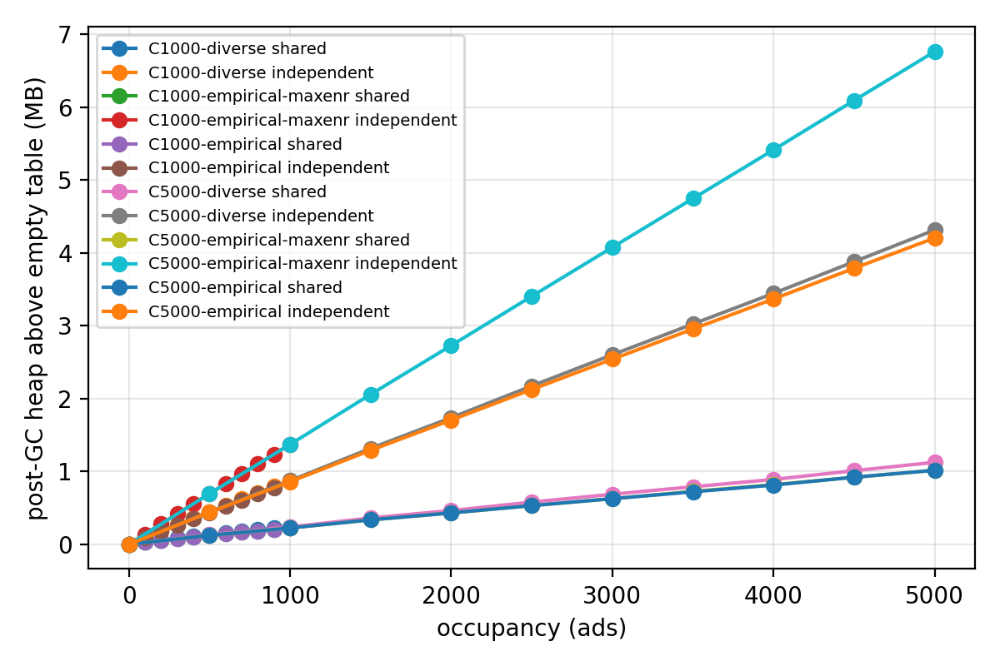
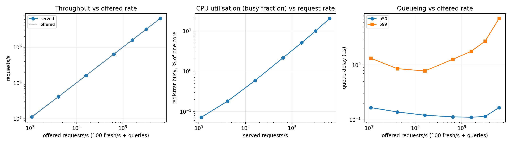
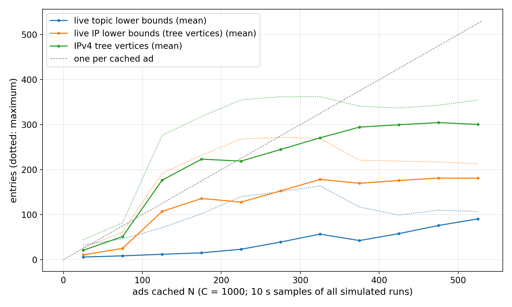

# TopDisc Registrar Overhead

This report measures the CPU and memory cost of a single TopDisc registrar in the
go-ethereum implementation (`p2p/discover/topicindex`). The algorithms are specified
in [discv5-theory.md]; their design goals, in particular *Bounded Registrar Storage*
and *Registrar Resource Exhaustion*, are explained in [discv5-rationale.md].

## 1. Summary

**What was measured.** One TopDisc registrar, as implemented in go-ethereum (revision
`7f1f7909692d`), on one core of an Apple M5. A benchmark program, called the *harness*
in this report, generates registration and lookup requests and calls the registrar
code directly, without a network. Each simulated advertiser registers one of 300
topics, with popularity skewed so that the most popular topic has about 16% of the
advertisers, and uses the IP address of a node found by the Ethereum discv4 network
crawler; §5 describes this workload and §6.5 varies it.

**Terms used below.**

* **Registrar core**: the topic table, the data structure that stores advertisements
  (the *ad cache*) and decides which to admit. For a registration request
  (`REGTOPIC`) it checks whether the advertiser already has an ad for that topic,
  computes how long the advertiser must wait, and then either admits the ad or replies
  with a waiting time and a ticket. The waiting time is higher when the cache is fuller,
  when the topic already holds a large share of the cache, and when the advertiser's IP
  address is similar to many cached ones. For a lookup request (`TOPICQUERY`) the
  registrar core picks up to 16 cached ads of the requested topic.
* **Validation**: the work the message handler does around the registrar core for a
  registration request. It decodes the advertiser's node record (ENR) and verifies its
  signature, checks that the record's IP address is the one the packet came from,
  verifies a ticket if one is presented, and creates a new ticket for a wait reply. A
  lookup request carries no node record, so it has no such cost.
* **Capacity C**: the maximum number of ads the cache may hold (default 1000).
  **Occupancy**: the number of ads it holds. **Ad lifetime E**: 15 minutes.
* **Fresh attempt**: a new registration attempt, that is, the first request from an
  advertiser, without a ticket. Rates are fresh attempts per second arriving at this one
  registrar; retries are not counted.
* **Advertisers** behave like the go-ethereum client: they retry when their waiting
  time ends, give up once the waiting times quoted to them add up to more than 1.5 × E
  (22.5 minutes), and then avoid that registrar for one ad lifetime.

**Main results.**

1. **A registration costs about 20 µs, almost all of it signature verification.** The
   registrar core takes 0.3–0.5 µs to answer with a wait and 1.2–2.3 µs to admit an ad.
   With validation included, a registration costs about 20 µs, of which verifying the
   node record's signature is 94% and the registrar core 1.7%. One core can therefore
   handle about 49,000 registrations per second, limited by signature verification (§6.1).
2. **A lookup costs about 47 ns for every cached ad of the requested topic.** To return
   a random set of 16 ads, the implementation visits every ad of the topic, so the
   16-result limit does not bound the work: 0.6 µs for a topic with 16 ads, 191 µs for
   one with 4,096. The duplicate check of a registration also walks the topic's ads.
   Costs therefore depend on how many ads the requested topic has, not on how full the
   cache is overall (§6.1).
3. **One core is the limit, and it is far from reached in practice.** All registrar work
   runs one request at a time on the single thread that also handles the rest of
   Discovery v5. At C = 1000 the harness offered up to 640,000 requests per second
   (mostly lookups); all were served without queues building up, and the registrar core
   was busy 20% of the time, so the maximum sustainable rate was not reached. At
   C = 5000 the same rate could not be sustained (620,000 served, queues of tens of
   seconds), because longer topic lists make each lookup slower: 1.1 µs against 0.32 µs
   (§6.4). The busiest registrar in the 10,000-node network runs (about 355
   registrations and 5 lookups per second) would use about 0.7% of one core (§6.7).
4. **The cache fills to only about a quarter of its capacity, whatever the demand.** At
   C = 1000, occupancy settles at 22–27% of capacity for 0.25 to 100 fresh attempts per
   second, and at about the same fraction for capacities from 500 to 10,000. The waiting
   time grows very steeply with occupancy (the formula divides by (1 − occupancy/C)¹⁰), so
   at about 25% occupancy a typical waiting time exceeds what the client will wait, and
   advertisers give up. The admission rate therefore stops rising, at about 0.30 ads per
   second for C = 1000; at 100 fresh attempts per second, 99.7% of attempts are abandoned
   and the registrar handles 451 registration messages per admitted ad. Admitted
   advertisers waited a median of about 18 minutes. The client's give-up time, not the
   cache capacity, determines how full the cache gets (§6.2, §6.5).
5. **Memory is small and bounded.** Each cached ad takes about 860 bytes, or 1,370 bytes
   with the largest allowed node record (300 bytes); most of it is the decoded node
   record. A full default cache takes 1.31 MiB (mebibytes); at the observed occupancy,
   about a quarter of that. The other state the registrar keeps, the lower bounds on
   waiting times per topic and per IP prefix, stays proportional to the cache contents:
   at most 1.0 topic bound and 1.5 IP bounds per cached ad were observed. The
   specification's claim that registrar storage is bounded holds (§6.3, §6.6).
6. **The implementation's waiting time differs from the specification.** It has an
   extra factor of 0.1; together with the client's give-up time, this factor sets the
   quarter-full level. The other differences are listed in §4.

## 2. Scope

Measured: the cost of processing registration and lookup requests in the registrar
core, the cost of validating registration requests, the memory the registrar holds, how
full its cache gets under realistic demand, and the request rate one CPU core can
sustain.

Not measured: network input and output, packet decryption and session handling,
encoding of responses, selection of the auxiliary node records returned with
responses, behaviour across many registrars, and adversarial workloads.

## 3. Background: what the registrar does per request

**Registration request (`REGTOPIC`).**

1. Decode the advertiser's node record and verify its signature.
2. Check that the record's IP address is the one the packet came from.
3. If a ticket is presented, verify it and check that it has not already been used
   ([Tickets]).
4. Check whether the advertiser already has an ad for this topic ([Ad Cache]).
5. Compute the waiting time from the cache occupancy, the topic's share of the cache and
   the similarity of the advertiser's IP address to cached ones, and do not let it fall
   below the stored lower bounds ([Waiting-Time Function], [IP Similarity Tree],
   [Waiting-Time Lower Bound]).
6. Admit the ad if the advertiser has waited long enough; otherwise reply with the
   remaining waiting time and a new ticket ([Admission Control]).

Steps 1–3 and the ticket of step 6 are *validation*; steps 4–6 are the *registrar core*.

**Lookup request (`TOPICQUERY`).** The registrar core returns up to 16 randomly chosen
cached ads of the requested topic ([Lookup Responses]). The handler then adds auxiliary
node records and encodes the response; those two steps are not measured here.

**How the implementation does this.**

* The ad cache keeps one list of ads per topic. The duplicate check of step 4 walks the
  requested topic's list, and so does a lookup: it visits every ad of the topic to pick a
  random 16 and to filter out addresses that should not be returned to the requester.
* The waiting time is computed as

      base = 0.1 · E / (1 − N/C)^10
      wait = base · (T/(N + 1) + s + G),   each part no lower than its stored bound

  where N is the occupancy, T the number of cached ads of the requested topic, s the
  advertiser's IP-similarity score (0 to 1) and G = 10⁻⁷. A single quoted wait is
  capped at 24 hours, and an ad is admitted once its remaining wait is at most 1 second.
* All registrar work runs on the single thread that handles every Discovery v5 packet,
  so one CPU core is the limit, shared with the rest of the protocol.

## 4. Differences from the specification

Waiting times stay capped at 24 hours even with a nearly full cache, and the
IP-similarity tree stays consistent as ads come and go; both are checked by tests. The
implementation differs from the specification in the following points:

| item | specification ([discv5-theory.md]) | implementation |
|---|---|---|
| scale of the waiting time | E / (1 − c/C)^Pocc · (…) | an extra factor of 0.1 |
| topic term | c(topic) / c | T / (N + 1); differs only when the cache is nearly empty |
| safety constant G | G = 10⁻⁷ | G = 10⁻⁷, also multiplied by the factor 0.1 |
| admission | when the remaining wait is ≤ 0 | when the remaining wait is ≤ 1 s |
| longest single wait | should not exceed E | capped at 24 hours |
| ticket binding | to the advertisement (`adDigest`: topic, node record, payload) | to the advertiser's node ID |
| LAN addresses | IP similarity concerns advertisers' addresses | LAN and special addresses are scored like public ones |
| client give-up time | left to implementations | 1.5 × E, then the registrar is avoided for one ad lifetime |

The factor of 0.1 and the client's give-up time together determine how full the cache
gets (§6.2): without the factor, the same client would fill only about 10% of the cache.

## 5. Method

**Harness.** The harness drives one registrar's topic table directly, with the
production code unmodified. Three kinds of runs are used:

* **microbenchmarks** measure the cost of each operation for controlled cache states
  (10 runs each);
* **simulated-time runs** follow the registrar for 18 hours of simulated time (the first
  6 hours as warm-up) to measure occupancy, waiting times and admissions; each
  configuration is run with 5 random seeds and reported as a mean with a 95% confidence
  interval;
* **realtime runs** measure throughput on the wall clock: after a 3-hour simulated
  warm-up, requests arrive at random (Poisson) times for 10 minutes, and the harness
  waits between arrivals by busy-waiting, so that CPU power saving does not slow it down.

Platform: Apple M5, macOS, Go 1.25, native arm64 binaries.

**Workload.**

* **Advertisers:** 200,000 identities, each with a signed node record and one topic.
* **Topics:** 300, with popularity following a Zipf distribution: the topic of rank r is
  chosen with probability proportional to 1/r^α. At the baseline α = 1, which gives the
  most popular topic 15.9% of the advertisers; α = 0 makes all topics equally popular.
* **IP addresses:** the IPv4 addresses of nodes found by the Ethereum Foundation's discv4
  crawler (`all.json` in `github.com/ethereum/discv4-dns-lists`, September 2026: 30,054
  node records, 18,823 distinct addresses), sampled so that an address shared by several
  nodes keeps its real frequency. Two synthetic sets bracket them: *diverse* (unique
  random addresses) and *concentrated* (all advertisers in eight /16 networks).
* **Requests:** fresh attempts and lookups arrive at fixed rates; lookups use the same
  topic popularity.
* **Baseline:** C = 1000, E = 15 minutes, 5 fresh attempts and 20 lookups per second.

One topic per advertiser keeps the relation between demand and cache contents simple.
Topic popularity is skewed because real services are, and real node addresses are used
because the IP-similarity part of the waiting time depends on how addresses cluster in
networks.

**Advertisers** behave like the go-ethereum client (§1): they retry exactly when their
waiting time ends, give up once the quoted waiting times add up to more than 22.5
minutes, and then leave this registrar for one ad lifetime. An admitted advertiser stays
until its ad expires; renewals are not modelled.

## 6. Results

### 6.1 Cost per request

*Figure 1: Registrar-core time per call against occupancy at C = 1000, with the
requested topic holding a tenth of the cached ads. A registration answered with a wait
takes 0.3–0.5 µs and one that admits the ad 1.2–2.3 µs; a lookup grows with the
topic's size, to 3.9 µs at 95% occupancy.*

* **Registration in the registrar core** costs 0.3–0.5 µs when the reply is a wait and
  1.2–2.3 µs when the ad is admitted (Figure 1). The cost rises only with the number of
  cached ads of the requested topic, by about 1.5–1.9 ns per ad, because of the
  duplicate check.
* **A lookup** costs about 47 ns per cached ad of the requested topic: 0.6 µs for 16 ads,
  10.6 µs for 256 and 191 µs for 4,096. The overall cache size does not matter.
* **Expiring an ad** costs 0.2–0.8 µs; computing an IP-similarity score costs
  0.03–0.19 µs, growing slowly with the number of cached addresses.

**A full registration is dominated by validation.** For a retry that receives a new
ticket:

| step | time | share |
|---|---|---|
| decode the node record and verify its signature | 19.0 µs | 93.7% |
| check the address against the packet source | 0.1 µs | 0.6% |
| verify the presented ticket and check it was not used before | 0.5 µs | 2.2% |
| create the ticket for the wait reply | 0.4 µs | 1.8% |
| registrar core (at 25% occupancy) | 0.3 µs | 1.7% |
| **total** (without packet decryption and network) | **20.3 µs** | 100% |

These figures use the C library for signature verification, as release builds of
go-ethereum do. With the pure-Go fallback, signature verification takes 88 µs and the
registrar core's share falls to 0.4%.

### 6.2 How full the cache gets

*Figure 2: Occupancy (top), admissions per second (middle) and the fractions of attempts
abandoned and of requests answered with a wait (bottom), against fresh attempts per
second, for C = 1000 and C = 5000 (5 seeds, mean and 95% confidence interval). At
C = 1000 occupancy settles at 22–27% of capacity and admissions stop rising at about 0.30
per second; extra demand is abandoned.*

There are two regimes (Figure 2):

* **When demand is low,** every attempt is eventually admitted and occupancy grows with
  demand (attempts per second × ad lifetime). At C = 5000 this holds up to 1 fresh
  attempt per second: 900 ads, all attempts admitted.
* **Above that,** occupancy stops growing and extra demand is turned away. At C = 1000
  this is already the case at 0.5 attempts per second. At 100 attempts per second,
  occupancy is 27% of capacity, 99.7% of attempts are abandoned, and the registrar
  handles 451 registration messages per admitted ad.

**Why a quarter.** The client gives up when the quoted waits exceed 1.5 × E. With the
implemented formula, the first quote reaches that limit at the occupancy u where

    u = 1 − ((x + s) / 15)^(1/10),

with x the topic's share of the cache and s the IP-similarity score. For x + s between
0.25 and 2 this gives 18–34%, and the measured levels (22–27% at C = 1000, 24–26% at
C = 5000) fall in that range. Because of the tenth root, the level hardly depends on
demand, on capacity or on the workload.

**Other observations.**

* Admitted advertisers waited a median of 18 minutes (95th percentile 22 minutes), so
  most were admitted shortly before they would have given up.
* The waiting time spreads the cache across topics: the most popular topic has 15.9% of
  the advertisers but holds 9.6% of the cache. The longest topic list seen was 45 ads at
  C = 1000 and 175 at C = 5000, which keeps lookups cheap (§6.1).
* For capacities from 500 to 10,000, occupancy stays at 24–28% of capacity, so the number
  of cached ads, and the admission rate (0.15 to 2.7 per second), grow in proportion to C.

### 6.3 Memory

*Figure 3: Memory held by the registrar against the number of cached ads, at C = 1000
and C = 5000, for typical and maximum-size node records. Memory grows linearly: about
860 bytes per ad with typical records and 1,370 bytes with 300-byte records.*

Each cached ad takes about 860 bytes with typical node records and 1,370 bytes with the
largest allowed record (300 bytes) (Figure 3). Of the 860 bytes, about 640 are the
decoded node record, which the registrar keeps in parsed form, several times its
134-byte encoded size; the registrar's own structures take about 220 bytes.

| capacity | full cache, typical records | full cache, 300-byte records |
|---|---|---|
| C = 1000 | 0.82 MiB | 1.31 MiB |
| C = 5000 | 4.0 MiB | 6.4 MiB |

Because the cache settles at about a quarter of capacity (§6.2), actual memory is about
a quarter of these figures.

### 6.4 Throughput

*Figure 4: Requests served per second (top), fraction of one core spent in the registrar
core (middle) and queueing delay (bottom), against requests offered per second, at
C = 1000 and C = 5000, with 100 fresh attempts per second and the rest lookups. C = 1000
is served in full up to the highest rate offered; C = 5000 saturates at 640,000 lookups
per second.*

Because the harness busy-waits between requests, CPU time does not measure load. The
middle panel therefore shows the time spent inside the registrar core as a fraction of
wall-clock time.

* **C = 1000:** every offered rate up to 640,000 requests per second was served in full.
  The registrar core was busy 20% of the time, and 99% of requests waited less than
  8 µs in the queue. The maximum sustainable rate is therefore above 640,000 requests
  per second.
* **C = 5000:** at 640,000 lookups per second the harness served 620,000; queues grew to
  tens of seconds, and the registrar core was busy 70% of the time. Each topic holds
  about five times as many ads, so a lookup costs 1.1 µs instead of 0.32 µs. The rest of
  the thread's time went to the harness itself.
* **Registrations only:** with validation included, one core can handle about 49,000
  registrations per second (§6.1).

### 6.5 Sensitivity

* **Client give-up time.** It is the parameter that controls occupancy. If advertisers
  never gave up, occupancy at 1 attempt per second would rise from 24% to 44% of
  capacity, but admitted advertisers would wait a median of 17 hours. Giving up when a
  single quote exceeds E, as the specification suggests, gives about the same occupancy
  as the go-ethereum client (24–29%).
* **Topic popularity:** from all topics equally popular (α = 0) to strongly skewed
  (α = 1.5), occupancy changes only from 26% to 25%. At α = 1.5 the most popular topic
  has 40% of the advertisers but holds 19% of the cache.
* **IP addresses:** occupancy is 23% with concentrated addresses, 26% with the crawler's
  addresses and 28% with diverse ones: the more similar the addresses, the longer the
  waits.
* **Lookup rate** (1 to 1,000 per second) does not change occupancy or waiting; lookups
  only cost CPU time.

### 6.6 Bounded registrar state

*Figure 5: Lower-bound entries for topics and IP prefixes, and IP-similarity tree
vertices, against the number of cached ads, over every 10-second sample of the C = 1000
runs (solid: mean, dotted: maximum). All stay at or below about 1.5 entries per cached
ad.*

Besides the ads, the registrar keeps lower bounds on waiting times, one per topic and
one per IP prefix, and the IP-similarity tree. All of these stay proportional to the
cache contents (Figure 5): at most 1.0 topic bound, 1.5 IP bounds and 2.0 tree vertices
were observed per cached ad, and the largest topic-bound state seen was about 16 kB. A
stress test with 50,000 topics, most of them requested while not in the cache, gave the
same picture. Pending registrations hold no state at the registrar, because the ticket
carries it.

### 6.7 Load in a real network

The 10,000-node network evaluations of an earlier revision of TopDisc report how many
requests individual registrars received. At the busiest registrar, about 355
registrations and 5 lookups per second (read from the reports' figures), the measured
costs add up to about 0.7% of one core. A typical registrar received about 0.1 lookups
per second and almost no registrations. The rate served in full at C = 1000 is about
1,800 times the busiest registrar's load.

## 7. Implications

* **CPU:** the cost of a registration is set by signature verification, not by the
  registrar. The registrar's own cost grows with the number of ads of the requested
  topic, because both the duplicate check and the lookup walk the topic's full list.
  With the waiting time keeping topic lists short, this is cheap, but a large topic
  costs O(T): 191 µs per lookup at 4,096 ads. Implementations should bound the lookup
  work (for example by sampling a fixed number of positions) and index the duplicate
  check by node ID.
* **Memory:** budget the decoded node record, not the encoded one: up to 1,370 bytes per
  ad, 1.31 MiB for the default capacity. The bounded-storage argument of the
  specification holds.
* **How full the cache gets** is set together by the scale factor of the waiting time,
  the occupancy exponent (10) and the client's give-up time. If a different target is
  intended, these should be chosen together, and the specification should state the
  client's give-up time or the intended occupancy, because occupancy depends on it more
  than on any registrar parameter.
* **Specification alignment:** the specification and the implementation should agree on
  the factor of 0.1 (and whether G is multiplied by it), the admission threshold, the
  longest single wait, and what a ticket is bound to (§4).

## 8. Limitations

* One registrar is studied. An advertiser that gives up comes back to it only as a new
  attempt; in a network it would try another registrar.
* Advertisers have one topic, do not renew their ads and use IPv4 addresses only.
* Only the registrar core and the validation of registrations are measured; packet
  decryption, sessions and response encoding come on top.
* One platform (Apple M5, macOS); which kind of core ran the harness could not be
  controlled.
* The 10,000-node loads come from an earlier revision and were partly read off figures.
* Some realtime runs with many registrations overlapped other activity on the machine;
  their queueing-delay tails are not reported.

## 9. Reproduction

The harness and scripts are on branch `registrar-overhead` of `datahop/go-ethereum`, in
`p2p/discover/topicindex/cmd/registrarbench/study/`; `regenerate.sh` rebuilds all
tables and figures from the raw results. The IP-address dataset is not in the
repository: it is extracted from `all.json` of `github.com/ethereum/discv4-dns-lists`
at commit `1bcb9b092a7351441da644295ab8b55ed313d1cd` (SHA-256 of the extracted file
`77e38b412b13b521956cf18d84d46235137b0a06e3ebe1d8e7d84ea70092c815`).

[discv5-theory.md]: https://github.com/ethereum/devp2p/blob/master/discv5/discv5-theory.md
[discv5-rationale.md]: https://github.com/ethereum/devp2p/blob/master/discv5/discv5-rationale.md
[Ad Cache]: https://github.com/ethereum/devp2p/blob/master/discv5/discv5-theory.md#ad-cache
[Admission Control]: https://github.com/ethereum/devp2p/blob/master/discv5/discv5-theory.md#admission-control
[Tickets]: https://github.com/ethereum/devp2p/blob/master/discv5/discv5-theory.md#tickets
[Waiting-Time Function]: https://github.com/ethereum/devp2p/blob/master/discv5/discv5-theory.md#waiting-time-function
[IP Similarity Tree]: https://github.com/ethereum/devp2p/blob/master/discv5/discv5-theory.md#ip-similarity-tree
[Waiting-Time Lower Bound]: https://github.com/ethereum/devp2p/blob/master/discv5/discv5-theory.md#waiting-time-lower-bound
[Lookup Responses]: https://github.com/ethereum/devp2p/blob/master/discv5/discv5-theory.md#lookup-responses
