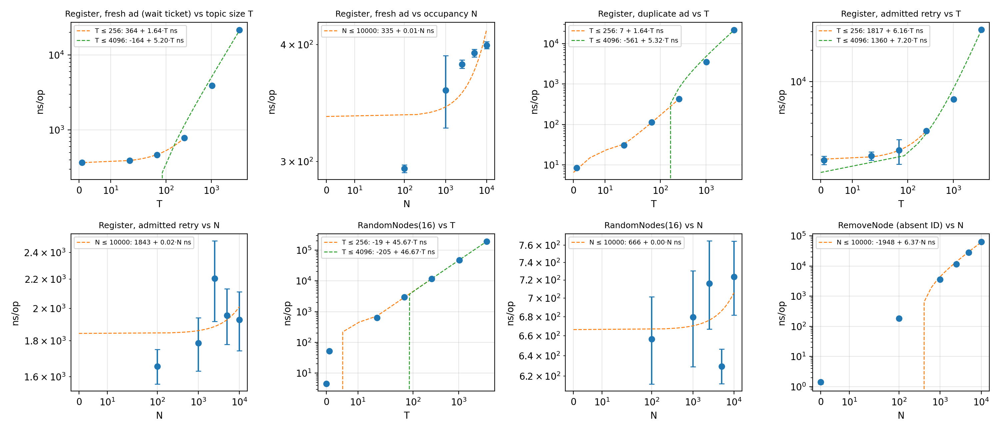
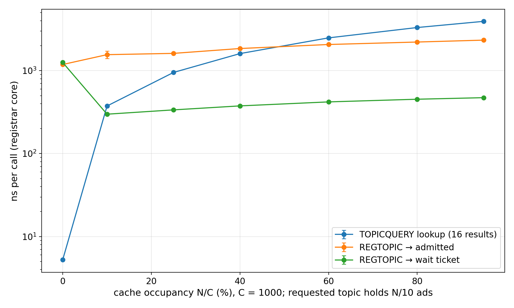
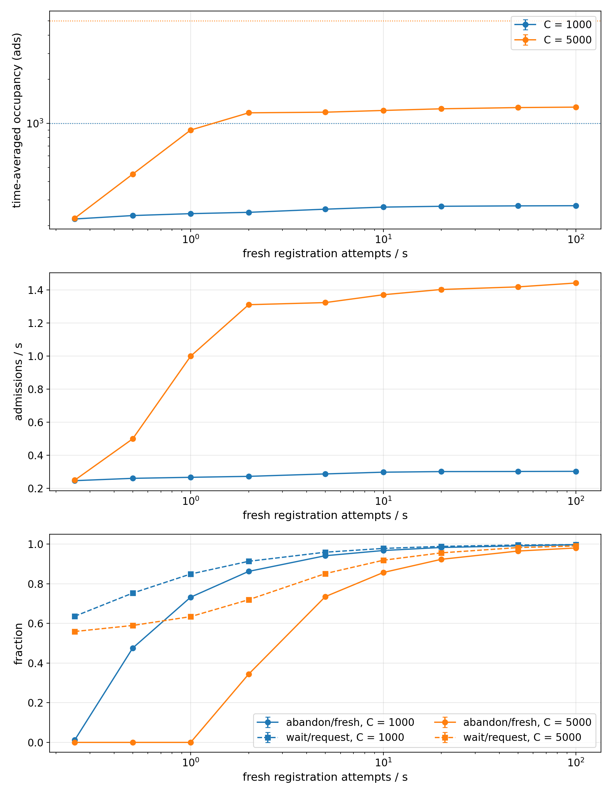
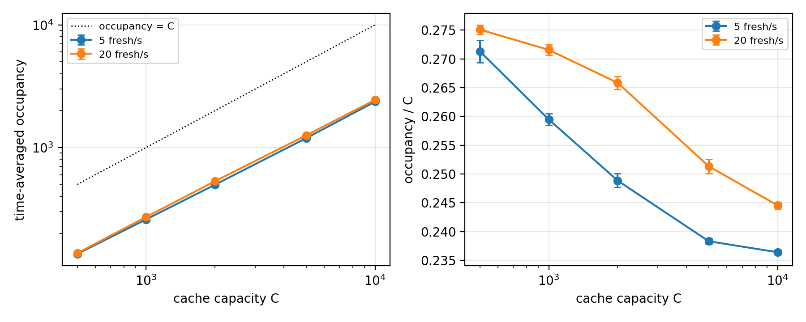
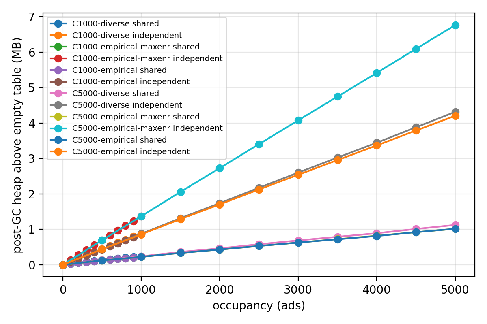
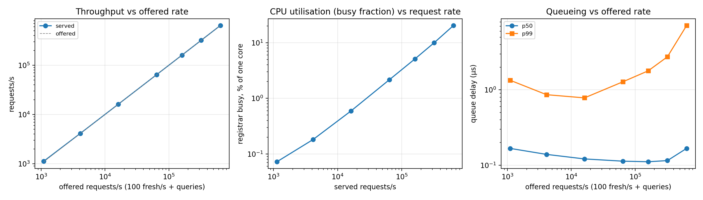
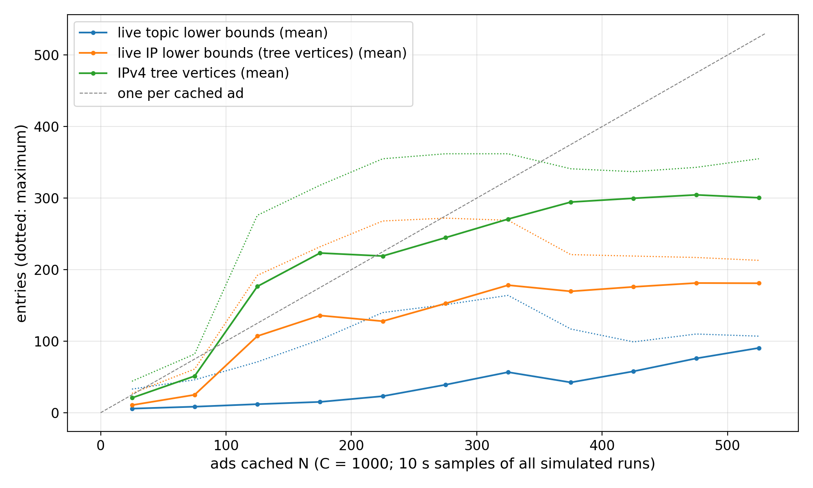

<!-- Generated by topicindex/cmd/registrarbench/study/study.py from registrar-overhead.md.in. Do not edit. -->
# TopDisc Registrar Overhead

This document reports the CPU, memory and admission-dynamics overhead of a single
TopDisc registrar, measured on the go-ethereum implementation
(`p2p/discover/topicindex`). It complements [discv5-theory.md] (algorithms) and
[discv5-rationale.md] (design goals, in particular *Bounded Registrar Storage* and
*Registrar Resource Exhaustion*). Results are stated as measurements; normative
language (MUST, SHOULD) is used only in the recommendations of §7.

All numbers, tables and figures in this document are generated by
`topicindex/cmd/registrarbench/study/regenerate.sh` from the raw result files (§9).

## 1. Summary

All results describe the production code after the fixes merged into `topdisc`
(§4, §5.5). The first version of this study (old code) is on branch
`registrar-overhead-oct27`; §6.8 compares the two.

* **The registrar core is cheap per request; validation dominates.** A `REGTOPIC`
  that receives a wait ticket costs 372 ns plus
  1.88 ns per cached ad of the requested topic; it grows with occupancy
  only through that term (§6.1). With record decoding, signature verification and
  ticket handling included, a full `REGTOPIC` costs about 20,000 ns, of which
  the registrar core is 1.7%. A `TOPICQUERY` lookup visits every cached
  ad of the topic (46.6 ns each), regardless of the 16-result
  limit. All registrar work runs on the single Discovery v5 dispatch goroutine (§3.3).
* **With production advertisers, occupancy settles well below C.** At C = 1000 the
  time-averaged occupancy is 22.2% of C at
  0.25 fresh attempts/s and
  27.4% at 100/s. Admissions saturate
  at 0.30/s; further demand becomes abandoned attempts
  (99.7% of fresh attempts) and
  451 `REGTOPIC` per admission. Admitted advertisers
  waited a median of 1,106 s (p95
  1,340 s; E = 900 s) at 5 attempts/s (§6.2).
* **Memory is dominated by the decoded ENR.** Each cached ad costs
  859 ± 1 B with typical records and
  1,370 B with maximum-size records; a full
  default cache (C = 1000) of maximum-size records holds
  1.31 MiB (§6.3). Lower-bound state stays
  bounded by the cache contents (§6.6).
* **Throughput.** On one core the harness served up to 640,000 requests/s
  without queueing (§6.4.2); the registrar core used at most 20.4% of that core
  in the sweep.
  The hottest registrar of the 10k-node runs would keep a core
  0.72% busy (§6.7).
* **Findings (§4).** F1 (waiting-time overflow), F2 (IP-tree counters under churn)
  and F4 (ticket binding) are fixed, each with a regression test; G is restored and the
  default capacity is now 1000. F3 (ticket keys expire before a 24 h quote ends) is
  still open, as are the spec decisions D1, D2, D4 and D7 (§4.2).

## 2. Scope

The object of study is the **registrar core**: the `topicindex.TopicTable` data
structure that stores admitted advertisements (the ad cache) and implements admission
control (waiting-time function, IP-similarity tree, lower bounds) and lookup.

Measured:

* the cost of `TopicTable.Register` (admission decision, duplicate check, insertion),
  `TopicTable.RandomNodes` (lookup with the production `TOPICQUERY` filter),
  `TopicTable.Expire` and `TopicTable.RemoveNode`;
* the state held by the registrar: ad-cache entries, decoded ENRs, IP-similarity tree
  vertices and lower-bound entries;
* the admission dynamics a registrar experiences under a population of advertisers
  that behave like the production client (§5.3): occupancy, waiting times, retry and
  abandonment rates;
* the throughput of the registrar core on one CPU core (provisional, §6.4.2).

Not measured: UDP I/O, Discovery v5 packet encoding, session cryptography and
handshakes, ticket MAC computation and encoding, ENR signature verification of incoming
records, auxiliary-ENR selection, response packetisation, and multi-registrar
(network-level) behaviour. Adversarial workloads are out of scope; the only
correctness check under unusual load is the bounded-state verification of §6.6.

The registrar core is a lower bound on the per-request cost of a full `REGTOPIC` or
`TOPICQUERY` handler. A wire-level handler benchmark is listed as deferred work (§10.3).

## 3. System under test

### 3.1 Data structures

| structure | contents | per-entry cost |
|---|---|---|
| ad cache | doubly linked list of all entries in insertion (= expiry) order, plus one list per topic | one entry, two list elements |
| advertiser record | the `*enode.Node` decoded from the `REGTOPIC` ENR | one decoded record |
| IP-similarity tree | binary trie over IPv4 (and IPv6) prefixes, a counter per vertex | ≤ 1 vertex per address in practice (§6.3) |
| topic lower bounds | `map[TopicID]lowerBound`, entries removed when the topic's last ad leaves | one map entry per occupied topic |
| IP lower bounds | a `lowerBound` field in each tree vertex | none (inline) |

### 3.2 Operations and complexity

| operation | work |
|---|---|
| `Register` | duplicate check by linear scan of the topic list (O(T)); waiting-time computation; IP-tree scoring and lower-bound path walk (O(log N)); on admission, list and tree insertion |
| `RandomNodes(topic, 16, check)` | reservoir sampling over the **whole** topic list, calling `check` (`netutil.CheckRelayAddr`) for every entry: O(T), independent of the result limit 16 |
| `Expire` | pops expired entries from the head of the global list; per entry: list removals, IP-tree removal (decodes the IP from the ENR) |
| `RemoveNode` | linear scan of the whole cache: O(N) |

N is the cache occupancy and T the number of cached ads for the requested topic.

### 3.3 Concurrency model

All `TopicTable` access happens on the single `dispatch` goroutine of `UDPv5`
(`v5_udp.go`: `handlePacket` for `REGTOPIC`/`TOPICQUERY`, the expiry alarm, and
`RemoveNode` via `onDispatchCh`). The same goroutine also handles every other
Discovery v5 packet. Registrar-core throughput is therefore bounded by **one CPU
core**, shared with the rest of the Discovery v5 protocol; capacity is reported per
core.

### 3.4 Waiting-time function as implemented

For a request for topic t from an advertiser with IP score s, with N ads cached and
capacity C:

```text
base       = 0.1 · E / (1 − N/C)^10
service    = base · T / (N + 1)            (0 when T = 0, also at N = C)
ip         = base · max(score_IPv4, score_IPv6)
required   = max(service, remaining topic bound) + max(ip, max remaining bound on the IP path)
             + base · G                     (G = 10⁻⁷, not lower-bounded)
quote      = min(required, 24 h)
admit if     credited ≥ quote − 1 s         (credited per the ticket's timing, §4.2 D9)
otherwise    return quote − credited, and record the service and IP bounds
if full:     return the time until the next expiry
```

Expired ads are removed at the start of every `RegisterAt`, `RandomNodes`, `Add` and
`WaitTime` call (#173), and the handler reads the clock once per request (#165).

## 4. Findings and their resolution

§4.1 lists the findings of the first study, the pull requests that fixed them, and the
regression tests. §4.2 re-checks the specification differences that are decisions for
the specification editors. Nothing in `topicindex` was changed for this study.

### 4.1 Findings and their resolution

The first version of this study (backup branch `registrar-overhead-oct27`, production
code at `2a8e47735`) reported five findings. `topdisc` has since merged fixes for most
of them. Every result in this document was measured on the new code (§5.5). Each
finding now has a regression test that passes on the new code, or, where the finding
is still open, a characterisation test that records the current behaviour. The test
output quoted here comes from `run_findings.sh` (§9), run on a clean tree for
GOARCH=arm64 and GOARCH=amd64.

| # | finding (old code) | fix | regression / characterisation test | status on the new code |
|---|---|---|---|---|
| F1 | the float waiting time overflowed int64 above ~84% occupancy: admission without waiting (amd64), a −292-year wait at the client (arm64) | #155 (cap quotes at 24 h), #157 (saturating wire decode, client clamps sub-floor waits to 1 s) | `TestRegisterOverflowThreshold`, `TestRegisterHighOccupancyInvariants`, `TestRegisterFullCacheNaN` (`v5_topic_overflow_test.go`) | fixed: no overflowing occupancy on arm64 (yes) or amd64 (yes); invariants test PASS |
| F2 | IP-tree counters drifted under churn, so scores depended on insertion history | #159 (remove walks only the levels insert incremented) | `TestIPTreeCountersMatchContents`, `TestSpecIPScoreDeviation` (`topicindex/spec_conformance_test.go`) | fixed under churn (PASS); scores still differ from the spec while the tree grows (table below) |
| F3 | ticket keys (6 h lifetime) could expire before a long wait ended | — | `TestTicketOutlivesKey` | **open**: quotes are now capped at 24 h, still above the 6 h key lifetime |
| F4 | tickets were not bound to the advertiser: one advertiser's ticket admitted another | #160 (ticket carries the node ID; mismatches start a new attempt) | `TestTicketNotBoundToAdvertiser` (`v5_topic_ticket_test.go`) | fixed (PASS): the second advertiser is not admitted (admitted: false) |
| F5 | the waiting-time function deviated from the specification (D1–D5) | #170 restores G; #155 adds a 24 h cap | `TestSpecWaitTimeDeviations`, `TestSpecGTerm`, `TestSpecAdmissionFloor`, `TestSpecNoWaitCap` | partly: D3 resolved, D5 changed, D1/D2/D4 open (§4.2) |

**F1, waiting-time overflow.** `secondsToDuration` now caps every quote at
`maxWaitTime` = 24 h and maps NaN to 0, and `scaleBase` avoids 0·∞. At 80–100%
occupancy the registrar quotes the cap, the client decodes it intact
(`waitTimeFromMs` saturates) and does not admit without credit:

| occupancy | case | GOARCH=amd64 | GOARCH=arm64 |
|---|---|---|---|
| 80% | highshare-highip | wait 24 h; ticket: unknown ticket MAC keyID | wait 24 h; ticket: unknown ticket MAC keyID |
| 80% | highshare-lowip | wait 24 h; ticket: unknown ticket MAC keyID | wait 24 h; ticket: unknown ticket MAC keyID |
| 80% | lowshare-highip | wait 24 h; ticket: unknown ticket MAC keyID | wait 24 h; ticket: unknown ticket MAC keyID |
| 80% | lowshare-lowip | wait 24 h; ticket: unknown ticket MAC keyID | wait 24 h; ticket: unknown ticket MAC keyID |
| 85% | highshare-highip | wait 24 h; ticket: unknown ticket MAC keyID | wait 24 h; ticket: unknown ticket MAC keyID |
| 85% | highshare-lowip | wait 24 h; ticket: unknown ticket MAC keyID | wait 24 h; ticket: unknown ticket MAC keyID |
| 85% | lowshare-highip | wait 24 h; ticket: unknown ticket MAC keyID | wait 24 h; ticket: unknown ticket MAC keyID |
| 85% | lowshare-lowip | wait 24 h; ticket: unknown ticket MAC keyID | wait 24 h; ticket: unknown ticket MAC keyID |
| 90% | highshare-highip | wait 24 h; ticket: unknown ticket MAC keyID | wait 24 h; ticket: unknown ticket MAC keyID |
| 90% | highshare-lowip | wait 24 h; ticket: unknown ticket MAC keyID | wait 24 h; ticket: unknown ticket MAC keyID |
| 90% | lowshare-highip | wait 24 h; ticket: unknown ticket MAC keyID | wait 24 h; ticket: unknown ticket MAC keyID |
| 90% | lowshare-lowip | wait 24 h; ticket: unknown ticket MAC keyID | wait 24 h; ticket: unknown ticket MAC keyID |
| 95% | highshare-highip | wait 24 h; ticket: unknown ticket MAC keyID | wait 24 h; ticket: unknown ticket MAC keyID |
| 95% | highshare-lowip | wait 24 h; ticket: unknown ticket MAC keyID | wait 24 h; ticket: unknown ticket MAC keyID |
| 95% | lowshare-highip | wait 24 h; ticket: unknown ticket MAC keyID | wait 24 h; ticket: unknown ticket MAC keyID |
| 95% | lowshare-lowip | wait 24 h; ticket: unknown ticket MAC keyID | wait 24 h; ticket: unknown ticket MAC keyID |
| 99% | highshare-highip | wait 24 h; ticket: unknown ticket MAC keyID | wait 24 h; ticket: unknown ticket MAC keyID |
| 99% | highshare-lowip | wait 24 h; ticket: unknown ticket MAC keyID | wait 24 h; ticket: unknown ticket MAC keyID |
| 99% | lowshare-highip | wait 24 h; ticket: unknown ticket MAC keyID | wait 24 h; ticket: unknown ticket MAC keyID |
| 99% | lowshare-lowip | wait 24 h; ticket: unknown ticket MAC keyID | wait 24 h; ticket: unknown ticket MAC keyID |
| 100% | highshare-highip | wait 24 h; ticket: unknown ticket MAC keyID | wait 24 h; ticket: unknown ticket MAC keyID |
| 100% | highshare-lowip | wait 24 h; ticket: unknown ticket MAC keyID | wait 24 h; ticket: unknown ticket MAC keyID |
| 100% | lowshare-highip | wait 24 h; ticket: unknown ticket MAC keyID | wait 24 h; ticket: unknown ticket MAC keyID |
| 100% | lowshare-lowip | wait 24 h; ticket: unknown ticket MAC keyID | wait 24 h; ticket: unknown ticket MAC keyID |

A full cache with an empty topic and no IP answers 24h0m0s
(admitted: false). A 24 h quote is far above the
client's attempt budget (1.5·E), so a production advertiser abandons at once (§5.3).
The ticket of a 24 h quote cannot be redeemed anyway (F3).

**F2, IP-tree counters.** With #159, each entry remembers the depth to which it was
inserted and removal decrements exactly those levels. After churn the counters match
the cache contents, and scores equal the specification's. While the tree grows, an
address inserted when the tree was small is counted only down to the shallow depth
of that time, so scores still differ from the specification's definition until the
early addresses have left the cache:

| address set | history | scores ≠ spec | mean |Δscore| | tree vertices with wrong counter |
|---|---|---|---|---|
| diverse | growth-1000 | 106/200 | 0.089 | 491/768 |
| diverse | churn-1000x10 | 0/200 | 0.000 | 0/886 |
| concentrated | growth-1000 | 10/200 | 0.007 | 136/451 |
| concentrated | churn-1000x10 | 0/200 | 0.000 | 0/575 |

(`TestSpecIPScoreDeviation`: 1000 addresses inserted, or inserted and removed in 10
rounds of churn; 200 probe addresses scored against a reference implementation of the
specification.) A registrar is in the growth state only during its first ad lifetime
after start-up, so the residual deviation is transient.

**F3, ticket key lifetime (open).** Ticket MAC keys are collected 6 h after their last
use (`ticketKeyLifetime`). The registrar may quote up to 24 h, and a ticket for a wait
above 6 h is rejected as `unknown ticket MAC keyID` if the key was not used in between
(`TestTicketOutlivesKey`). Production advertisers abandon quotes above 1.5·E long
before that, so this does not affect the results. *Suggested fix:* cap quotes at or
below the key lifetime (a cap at E, D5, would do), or keep keys for at least
`maxWaitTime`.

**F4, ticket binding.** The ticket now carries the advertiser's node ID, and
`handleRegtopic` ignores a ticket presented by another node. In
`TestTicketNotBoundToAdvertiser`, advertiser A receives a wait of
2m27.37s; after that wait, B presents A's ticket, is treated as
a new attempt and receives its own quote. The handler also remembers credited tickets
(`UsedTickets`, at most 16,384 MACs for 15 s) so that a ticket is credited once, and
re-quotes early tickets without moving their window. The specification binds tickets
to `adDigest` (service, ENR and payload); binding to the node ID does not detect an
ENR change during an attempt (D6).

**F5, waiting-time deviations.** See D1–D5 below. G is restored (#170) but, like the
other terms, scaled by the factor 0.1: the empty-cache wait is
9µs against 89.999µs in the specification.

### 4.2 Specification-alignment decisions

These are behavioural choices for the specification editors, re-checked against the
new code. "Model" marks values derived from the waiting-time formula.

| # | item | specification (discv5-theory.md) | implementation (new code) | status | measured or derived effect |
|---|---|---|---|---|---|
| D1 | base scale | w = E/(1 − c/C)^Pocc · (…) | extra factor 0.1 (`waitTimeBaseModifier`) | open | Over 2,000 quotes on random cache states (`TestSpecWaitTimeDeviations`), implemented/spec ratio median 0.079, max 0.10; spec quotes exceed E in 95% of cases, implemented in 70%. Model: equilibrium occupancy 29% (x+s = 0.5) with the factor, 10% without. |
| D2 | service term | c(service)/c | T/(N+1) | open | Differs only at very small N. |
| D3 | safety constant G | G = 10⁻⁷ | `waitTimeSafety` = 10⁻⁷, times the base (which includes 0.1) | **resolved** (#170) | Empty-cache wait 9µs (spec 89.999µs); below the 1 s floor at any occupancy below 61%. |
| D4 | admission threshold | admit if t_remaining ≤ 0 | admit if t_remaining ≤ 1 s; the client raises sub-floor quotes to 1 s (#157) | open | 1.7% of the D1 sample quotes are at or below the floor; at most 1.1% of fresh requests were admitted immediately in any run. |
| D5 | single-wait cap | "a single waiting interval SHOULD NOT exceed E" | cap at 24 h (`maxWaitTime`, #155) | changed | A single quote of 1h19m36.410671451s at 32% occupancy (E = 15 min). |
| D6 | ticket binding | ticket bound to `adDigest` | ticket bound to the node ID (#160) | changed | A changed ENR during an attempt is not detected; not measured. |
| D7 | LAN addresses | the IP tree scores advertisers' addresses | LAN/special addresses are inserted and scored like public ones (`TestSpecLANAddressesInTree`) | open | Not measured (the empirical dataset contains only public addresses). |
| D8 | capacity default | C = 1000 | `AdCacheSize` default 1000 (#182) | **resolved** | C = 1000 is now the baseline of every experiment. |
| D9 | retry window | tmod + twait ≤ now ≤ tmod + twait + δ | on time in [start, start + 5 s); late tickets credited with the scheduled wait for 10 s more; early tickets re-quoted (#153 and later) | changed | Modelled exactly by the harness (`TestProductionRetryValidity`). |
| D10 | attempt timeout | implementation-defined ("MAY abandon") | client drops an attempt when one quote, or the sum of quotes, exceeds 1.5·E, and then skips that registrar for one ad lifetime | changed | Still the dominant factor in equilibrium occupancy (§6.2). |

## 5. Methodology

### 5.1 Instruments and the questions each may answer

| instrument | clock | answers | does not answer |
|---|---|---|---|
| `testing.B` microbenchmarks (`topicindex/bench_test.go`) | wall | per-operation cost vs N, T and IP-tree size; allocations | dynamics, throughput under load |
| simulated runs (`registrarbench --mode simulated`) | logical (`mclock.Simulated`) | occupancy, admission/wait/abandonment rates, waiting times, state sizes over hours of logical time | CPU utilisation, queueing, wall-clock throughput |
| memfill (`--mode memfill`) | none | bytes per cached ad (slope of post-GC heap vs occupancy) | — |
| realtime/hybrid runs (`--mode realtime/hybrid`) | wall | throughput, CPU per operation, queue delay, saturation | long-term dynamics (use simulated) |

Per-call latencies recorded by the harness are quantised by the platform timer
(41 ns resolution on the test machine; most
lookups take only a few ticks). They are used only as distributions of expensive
operations; per-operation cost comes from the microbenchmarks.

### 5.2 Workload model

`registrarbench` drives one `TopicTable` directly; the production registrar code is
used unmodified. The workload:

* **Advertiser population:** a fixed set of identities, generated before timing, each
  with a signed ENR (IPv4, UDP port) and **one** topic drawn from a Zipf(α)
  distribution over the topics.
* **IP addresses** come from one of three distributions:
  * `empirical`: rows of a public-IP dataset sampled with replacement (SHA-256
    `77e38b412b13b521956cf18d84d46235137b0a06e3ebe1d8e7d84ea70092c815`);
  * `diverse`: unique random public IPv4 addresses;
  * `concentrated`: random hosts in eight random /16 prefixes.
* **Fresh registration attempts** arrive at a fixed rate and take the longest-idle
  advertiser. Simulated runs use deterministic inter-arrival times; realtime runs use
  Poisson arrivals. An arrival that finds no idle advertiser is counted as *population
  scarcity*, not banked as credit, and makes the run *load-invalid*.
* **Queries** (`RandomNodes(topic, 16, check)` with the production `TOPICQUERY` callback
  `netutil.CheckRelayAddr`) arrive at a separate fixed rate, with the topic drawn from
  the same Zipf distribution.
* **Expiry:** `Expire` runs at `NextExpiryTime()`, like the production dispatch
  timer. Ads due at the same instant expire in one call.

The parameters of each experiment are listed in §10.1. The baseline is C = 1000 (the
specification default), E = 15 min, 300 topics, α = 1, 200,000 advertisers, empirical
IPs, 5 fresh attempts/s and 20 queries/s. Simulated runs last 18 h of logical time, of
which the first 6 h are warm-up; the abandonment-policy runs last 36 h with 24 h of
warm-up (§8). State is sampled every 10 s.

In simulated mode, queries do not change registrar state. The query-rate experiment
(§10.1) gives identical dynamics at 1–1000 queries/s. Query load matters only for CPU
(§6.4).

### 5.3 Advertiser model

Advertisers behave like the production client, `topicindex.Registration.HandleTicketResponse`
(`--abandon production`; `TestAbandonmentMatchesProductionClient` checks the harness
against the production state machine):

1. The first request carries no ticket. A wait response is decoded as on the wire:
   ceil-milliseconds, then `waitTimeFromMs`, which saturates. A quote below the 1 s
   floor is raised to 1 s (#157).
2. The advertiser **drops the attempt if a single quote exceeds `RegAttemptTimeout`**
   (1.5·E = 22.5 min). Otherwise it adds the quote to its running sum and **drops the
   attempt if the sum exceeds `RegAttemptTimeout`**. Both comparisons are strict. Since
   the registrar credits the time since the first ticket, the sum of quotes is the
   advertiser's own estimate of its cumulative wait.
3. A continuing advertiser retries exactly when its wait ends. The registrar credits a
   retry in `[due, due + 5 s)` with the time since the first ticket, a late retry (up
   to 10 s more) with the scheduled wait, and treats a retry later than that as a new
   attempt (`regtopicCredit`; `TestProductionRetryValidity` compares the boundaries
   with `Ticket.TimingAt`). The handler's clock is read once per request, as
   `RegisterAt` in production (#165).
4. **An abandoning advertiser leaves this registrar for one ad lifetime.** The
   production client lists a registrar that quoted above its budget as overloaded and
   skips it for E (`TestAbandonCooldownMatchesProduction`). In the harness the
   advertiser rejoins the idle population after E and can come back only through a
   later fresh arrival, which starts a new attempt with no credit. (In a network, it
   would try another registrar instead.)
5. An admitted advertiser stays busy until its ad expires; renewals are not modelled.

Ads are expired outside the timed region before each call, as the dispatch loop's
expiry alarm does; `RegisterAt` and `RandomNodes` also expire internally (#173).

Two sensitivity policies (§6.5):

* `spec` drops an attempt when a single quote exceeds E, following "a single waiting
  interval SHOULD NOT exceed E". It has no cumulative limit.
* `none` never abandons, as in the original harness.

Every run reports the abandonment rate (per second and as a fraction of fresh
attempts), with the reason (single quote, cumulative, or wrapped wait). It also reports
the cumulative wait at admission (median and p95), both over all admissions and over
admissions after at least one wait.

### 5.4 Statistics

Each simulated configuration is run with 5 or more seeds. Tables
report the mean over seeds ± the 95% confidence half-width of the mean (Student t,
n−1 degrees of freedom). Waiting-time quantiles are histogram bucket upper bounds
(≤ 3.125% wide) per run, averaged over seeds.

Every run is checked for:

* **Little's law**: time-averaged occupancy (an exact time integral) divided by
  admission rate × E must be within ±2% of 1;
* **stationarity**: occupancy in the two halves of the measurement window must differ
  by ≤ 5%, and the wait fraction by ≤ 0.03;
* **load validity**: no fresh arrival may find the advertiser population exhausted.

Runs failing a check are listed in §10.2 and included in the aggregates only where
stated. Runs are admissible only if they record the git revision of a clean tree, Go
version, OS/architecture, CPU model and a Rosetta flag of false; inadmissible runs
are excluded and listed.

### 5.5 Platform

| item | value |
|---|---|
| CPU | Apple M5 (4 performance + 6 efficiency cores) |
| OS / architecture | darwin/arm64, native (Rosetta 2 translated: False) |
| Go | go1.25.0 |
| timer resolution | 41 ns |
| core type of the worker | not observable on macOS |

The installed Go toolchain is darwin/amd64. All study binaries were therefore built
with `GOARCH=arm64`, and each run records `sysctl.proc_translated`. Earlier results
were produced by amd64 binaries under Rosetta 2; they are not used here.

The validation benchmarks (§6.1) are built twice: with cgo, which uses libsecp256k1
for signature verification as release builds of geth do, and without cgo
(pure-Go verification). All other binaries are pure Go.

Results come from these revisions. The production registrar code
(`topicindex/*.go` except tests and `stats.go`) is identical across all of them
(checked with `git diff` by `study.py`):

| revision | results (files) | production registrar code vs 7f1f7909692d |
|---|---|---|
| 7f1f7909692d | audit (3), memfill (6), microbench (1), realtime (15), sim (240) | identical |

## 6. Results

### 6.1 Per-operation cost and complexity

`testing.B` benchmarks (`topicindex/bench_test.go`) were run natively on arm64, 10 runs
each; values are mean ± 95% CI. N is the cache occupancy and T the number of cached ads
for the requested topic. Full table: §10.1.



| operation | fit range | intercept (ns) | slope (ns per entry) | R² |
|---|---|---|---|---|
| Register, fresh ad (wait ticket) vs topic size T | T ≤ 256 | 372 | 1.88 ± 0.05 | 0.995 |
| Register, fresh ad (wait ticket) vs topic size T | T ≤ 4096 | -139 | 5.64 ± 0.10 | 0.995 |
| Register, fresh ad vs occupancy N | N ≤ 10000 | 337 | 0.01 ± 0.00 | 0.640 |
| Register, duplicate ad vs T | T ≤ 256 | 11 | 1.54 ± 0.01 | 1.000 |
| Register, duplicate ad vs T | T ≤ 4096 | -546 | 5.59 ± 0.12 | 0.994 |
| Register, admitted retry vs T | T ≤ 256 | 1,679 | 9.25 ± 0.24 | 0.994 |
| Register, admitted retry vs T | T ≤ 4096 | 1,758 | 7.53 ± 0.04 | 0.999 |
| Register, admitted retry vs N | N ≤ 10000 | 1,596 | 0.03 ± 0.01 | 0.704 |
| RandomNodes(16) vs T | T ≤ 256 | 4 | 41.36 ± 0.20 | 1.000 |
| RandomNodes(16) vs T | T ≤ 4096 | -1,069 | 46.60 ± 2.26 | 0.961 |
| RandomNodes(16) vs N | N ≤ 10000 | 600 | 0.00 ± 0.00 | 0.081 |
| RemoveNode (absent ID) vs N | N ≤ 10000 | -1,736 | 6.04 ± 0.13 | 0.994 |

* **`Register`, fresh ad receiving a wait ticket.** 372 ns
  + 1.88 ns·T for T ≤ 256, independent of N
  (299 ns at N = 100, 426 ns at N = 10,000).
  The T term is the duplicate check, a linear scan of the topic's linked list. Beyond
  T ≈ 256 the scan leaves the cache and costs 5.6 ns per entry
  (23,269 ns at T = 4096). Each call allocates
  108 B in 5 objects.
* **Duplicate `Register`** (the ad is already cached) stops at the duplicate check:
  12.8 ns at T = 1, 1.54 ns per entry, no allocations.
* **Admitted retry** (insertion into the lists and the IP tree):
  1,596 ns, independent of N.
* **`RandomNodes(topic, 16, check)`** visits every ad of the topic: reservoir sampling
  plus one `netutil.CheckRelayAddr` call per entry, at 46.6 ns per
  entry. The 16-result limit does not bound the work. An empty topic costs
  8.1 ns.
* **`Expire`**, in steady state: 214 ± 1 ns per expired
  entry in batches of 1000, and 792 ± 7 ns for a single entry. Each
  entry costs 5 allocations.
* **IP score** (tree walk): 33–193 ns
  for 10–100,000 addresses, logarithmic in N.
* **`RemoveNode`** scans the whole cache: 6.04 ns·N.

The allocation audit of the simulated baseline (C = 1000, 5 fresh/s, 20 queries/s,
independent ENR copies; 3 seeds) gives the per-call averages under the realistic
operation mix:

| quantity per call | mean ± 95% CI | seeds |
|---|---|---|
| expiry allocations | 5.35 ± 0.09 | 3 |
| expiry allocations per entry | 5.00 ± 0.00 | 3 |
| expiry bytes | 127.45 ± 1.94 | 3 |
| expiry bytes per entry | 119.03 ± 0.23 | 3 |
| query allocations | 0.78 ± 0.00 | 3 |
| query bytes | 48.73 ± 0.81 | 3 |
| registration allocations | 5.36 ± 0.01 | 3 |
| registration bytes | 132.95 ± 0.32 | 3 |

Per expired entry this is 119 ± 0 B in
5.00 allocations, matching the microbenchmark.

**Latency against occupancy.** At the default capacity C = 1000, with the requested
topic holding a tenth of the cached ads (`BenchmarkOccupancy`):



| operation | N/C | N | T | ns/call |
|---|---|---|---|---|
| lookup | 0% | 0 | 0 | 5 ± 0 |
| lookup | 10% | 100 | 10 | 375 ± 5 |
| lookup | 25% | 250 | 25 | 951 ± 8 |
| lookup | 40% | 400 | 40 | 1,605 ± 5 |
| lookup | 60% | 600 | 60 | 2,483 ± 6 |
| lookup | 80% | 800 | 80 | 3,308 ± 8 |
| lookup | 95% | 950 | 95 | 3,927 ± 15 |
| register-admit | 0% | 0 | 0 | 1,186 ± 22 |
| register-admit | 10% | 100 | 10 | 1,558 ± 163 |
| register-admit | 25% | 250 | 25 | 1,614 ± 42 |
| register-admit | 40% | 400 | 40 | 1,847 ± 53 |
| register-admit | 60% | 600 | 60 | 2,066 ± 25 |
| register-admit | 80% | 800 | 80 | 2,212 ± 22 |
| register-admit | 95% | 950 | 95 | 2,332 ± 20 |
| register-wait | 0% | 0 | 0 | 1,254 ± 32 |
| register-wait | 10% | 100 | 10 | 299 ± 2 |
| register-wait | 25% | 250 | 25 | 337 ± 2 |
| register-wait | 40% | 400 | 40 | 376 ± 2 |
| register-wait | 60% | 600 | 60 | 420 ± 2 |
| register-wait | 80% | 800 | 80 | 452 ± 3 |
| register-wait | 95% | 950 | 95 | 472 ± 2 |

A wait response costs 299–472 ns from 10% to 95%
occupancy and an admission 1,558–2,332 ns; neither
grows with the occupancy factor, which only changes the computed number. The lookup
grows with the topic size T = N/10: 375 ns at 10% and
3,927 ns at 95%. At N = 0 a registration is always admitted (no wait).


**Validation cost.** `handleRegtopic` does more than the registrar core. Per request it
decodes and verifies the advertiser's record, compares its address with the packet
source, unseals a presented ticket and checks it against the replay memory, and seals
a new ticket for a wait response (`v5_validation_bench_test.go`):

| build | benchmark | ns/op | B/op | allocs/op |
|---|---|---|---|---|
| cgo | ValidationENR/size=max | 19,644.2 ± 159.4 | 4,334 | 93.0 |
| cgo | ValidationENR/size=typical | 19,017.9 ± 27.9 | 3,925 | 87.0 |
| cgo | ValidationEndpoint | 116.9 ± 0.4 | 108 | 5.0 |
| cgo | ValidationTicket/op=pack | 363.4 ± 0.4 | 368 | 4.0 |
| cgo | ValidationTicket/op=replay-check | 49.7 ± 0.4 | 128 | 0.0 |
| cgo | ValidationTicket/op=unpack | 415.5 ± 0.8 | 240 | 3.0 |
| purego | ValidationENR/size=max | 88,640.5 ± 51.1 | 5,716 | 117.0 |
| purego | ValidationENR/size=typical | 88,445.0 ± 592.1 | 5,291 | 111.0 |
| purego | ValidationEndpoint | 114.5 ± 0.8 | 108 | 5.0 |
| purego | ValidationTicket/op=pack | 359.9 ± 0.3 | 368 | 4.0 |
| purego | ValidationTicket/op=replay-check | 47.7 ± 0.2 | 128 | 0.0 |
| purego | ValidationTicket/op=unpack | 423.2 ± 1.2 | 240 | 3.0 |

For a retry that receives a new ticket, the parts add up as follows (cgo build;
registrar core at 25% occupancy):

| step of a REGTOPIC retry that receives a new ticket | ns | share |
|---|---|---|
| ENR decode + signature | 19,018 | 93.7% |
| endpoint check | 117 | 0.6% |
| ticket unpack (retry) | 415 | 2.0% |
| replay check (retry) | 50 | 0.2% |
| ticket pack (wait reply) | 363 | 1.8% |
| registrar core (RegisterAt, N/C = 25%) | 337 | 1.7% |
| total (excluding packet decryption and I/O) | 20,300 | 100% |

The registrar core is 1.7% of this per-request work; ENR signature
verification is 94%. Without cgo (pure-Go secp256k1) the core's
share drops to 0.4%. Packet decryption, session handling
and response encoding come on top and are not measured.


### 6.2 Admission dynamics and equilibrium occupancy



Full per-point tables (mean ± 95% CI over 5 seeds) are in §10.1. Every run satisfies
Little's law: time-averaged occupancy / (admission rate · E) lies between
0.988 and 1.011.

**Two regimes.**

* *Demand-limited:* every attempt is eventually admitted, and occupancy equals
  λ_fresh · E. At C = 5000 this holds up to 1 fresh attempt/s:
  900 ± 0 ads, admission fraction
  1.000, no abandonment.
* *Waiting-time-limited:* above that, occupancy saturates and extra demand is turned
  away. At C = 1000 this regime already holds at 0.5 attempts/s:

| fresh attempts/s | occupancy / C | admissions/s | abandoned / fresh | `REGTOPIC` per admission |
|---|---|---|---|---|
| 0.50 | 0.235 ± 0.001 | 0.261 ± 0.001 | 0.476 ± 0.005 | 4.1 |
| 5 | 0.259 ± 0.001 | 0.288 ± 0.001 | 0.942 ± 0.002 | 24.7 |
| 100 | 0.274 ± 0.002 | 0.304 ± 0.002 | 0.997 ± 0.002 | 451.5 |

**Why the cache saturates near a quarter of C.** The production client gives up once
its quoted waits exceed 1.5·E. Admission therefore stops growing at the occupancy u
where a typical first quote reaches 1.5·E. Ignoring lower bounds and the 1 s floor, the
implemented wait is 0.1·E·(x + s)/(1 − u)^10, with topic share x = T/(N+1) and IP score
s. This gives

    u* = 1 − ((x + s) / 15)^(1/10)

which is 33.6%, 28.8%, 23.7% and
18.2% for x + s = 0.25, 0.5, 1 and 2. The measured equilibria of
24.7%–27.4% (C = 1000) and
23.6%–25.8% (C = 5000) fall in this
range. Because of the 10th root, the equilibrium hardly depends on demand, on C, or on
the workload (§6.5).

**Waiting.**

* Admitted advertisers waited a median of 1,106 s
  (p95 1,340 s) at the baseline. Most
  admissions happen shortly before the 1350 s attempt timeout.
* At the baseline, 80% of abandonments come
  from a single quote above 1.5·E; the rest from the sum of quotes.
* The p95 quoted wait is 2,721 s. Quotes above E
  are common because the registrar does not cap them (D5).
* No wrapped waits occurred. No retry missed its ticket window; in simulated mode this
  holds by construction.

**Topic diversity.** The service term flattens the topic distribution. At the
baseline, the most popular topic holds 15.9%
of the advertisers but only 0.096 ± 0.002 of the
cache. The largest topic list seen during measurement has
45 ads at the C = 1000 baseline and
175 at C = 5000 with 100 fresh attempts/s
(mean over seeds). These T values are what the
per-operation costs of §6.1 should be read at.



**Capacity.** Over C = 500 … 10,000 (§10.1, `capacity`) the occupancy fraction stays
between 23.6% and 27.5%. The
admission rate scales with C:
* 0.15/s at C = 500;
* 2.72/s at C = 10,000.

### 6.3 Memory

Bytes per cached ad are the slope of the post-GC live heap against occupancy. The
table is filled with `TopicTable.Add` at 0–100% of C, five repetitions. It is measured
two ways:

* `independent`: each ad holds its own decoded `enode.Node`, as in production, where
  `handleRegtopic` decodes the ENR from the packet;
* `shared`: the ENR is shared, so only the registrar's own structures are charged.



| run | ENR | C | bytes per cached ad | IPv4 tree vertices per ad | bytes per topic bound | MiB at occupancy = C |
|---|---|---|---|---|---|---|
| C1000-diverse | shared | 1000 | 236 ± 4 | 0.77 | 97 ± 0 | 0.22 |
| C1000-diverse | independent | 1000 | 876 ± 4 | 0.77 | 97 ± 1 | 0.84 |
| C1000-empirical-maxenr | shared | 1000 | 218 ± 1 | 0.46 | 97 ± 1 | 0.21 |
| C1000-empirical-maxenr | independent | 1000 | 1,370 ± 0 | 0.46 | 97 ± 0 | 1.31 |
| C1000-empirical | shared | 1000 | 218 ± 1 | 0.46 | 97 ± 0 | 0.21 |
| C1000-empirical | independent | 1000 | 859 ± 1 | 0.46 | 97 ± 0 | 0.82 |
| C5000-diverse | shared | 5000 | 221 ± 1 | 0.83 | 101 ± 0 | 1.05 |
| C5000-diverse | independent | 5000 | 860 ± 0 | 0.83 | 101 ± 0 | 4.10 |
| C5000-empirical-maxenr | shared | 5000 | 199 ± 1 | 0.38 | 101 ± 0 | 0.95 |
| C5000-empirical-maxenr | independent | 5000 | 1,351 ± 0 | 0.38 | 101 ± 0 | 6.44 |
| C5000-empirical | shared | 5000 | 199 ± 1 | 0.38 | 101 ± 0 | 0.95 |
| C5000-empirical | independent | 5000 | 839 ± 0 | 0.38 | 105 ± 11 | 4.00 |

Per ad, at C = 1000 with empirical addresses:

* **Registrar structures:** 218 ± 1 B (list
  entries, IP-tree share, map entries).
* **Decoded ENR:** 640 B for a
  134-byte record, and
  1,152 B for a 300-byte record (padded with an
  opaque entry). An `enode.Node` keeps the raw RLP, the signature and every key/value pair as separate
  slices (`enr.Record`), plus the decoded endpoint, so it costs several times the encoded
  size.
* **IP tree:** 0.46 IPv4 vertices per ad
  with empirical addresses, 0.77 with
  diverse ones.
* **Topic lower bound:** 97 ± 0 B per
  bound.

At full occupancy:

| C | records | measured | brief's bound C·(300 B + registrar overhead) |
|---|---|---|---|
| 1000 | typical | 0.82 MiB | 0.49 MiB |
| 1000 | 300-byte | 1.31 MiB | 0.49 MiB |
| 5000 | 300-byte | 6.44 MiB | 2.38 MiB |

The bound should be stated in terms of the decoded record size, not the encoded one.
At the measured equilibrium occupancy (§6.2), actual memory is about a quarter of these
figures.

### 6.4 Throughput, CPU and saturation

#### 6.4.1 Pacing and the cost of idle time

*These pacing runs are from the first study (first study (old code), branch
`registrar-overhead-oct27`); they were not repeated on the new code. Pacing concerns the
harness's idle strategy, which the registrar changes do not affect; the per-call
costs in them are those of the old registrar.*

Earlier realtime results reported registration latencies of tens of microseconds,
against sub-microsecond costs in the microbenchmarks. Before the realtime sweep, a
pacing check separated the possible causes. It ran two load points, each 15 min of real
time after a 6 h simulated warm-up (hybrid clock, Poisson arrivals, C = 1000, seed 1),
with each of two idle strategies between arrivals:

* `sleep`: the worker blocks on a timer;
* `spin`: the worker busy-waits.

| run | operation | calls | min µs | p50 µs | p99 µs | mean µs | queue delay p50 µs (all ops) | process CPU % of one core |
|---|---|---|---|---|---|---|---|---|
| C1000-fresh100-query1000-sleep | registration | 115997 | 0.33 | 6.29 | 26.83 | 6.62 | 162.80 | 3.5 |
| C1000-fresh100-query1000-sleep | query | 901189 | 0.00 | 1.83 | 23.42 | 3.82 | 162.80 | 3.5 |
| C1000-fresh100-query1000-spin | registration | 115999 | 0.33 | 1.17 | 7.25 | 1.43 | 0.16 | 99.9 |
| C1000-fresh100-query1000-spin | query | 901189 | 0.00 | 0.29 | 5.25 | 0.79 | 0.16 | 99.9 |
| C1000-fresh5-query20-sleep | registration | 6195 | 0.50 | 14.00 | 77.32 | 19.65 | 2,010.88 | 0.3 |
| C1000-fresh5-query20-sleep | query | 17980 | 0.00 | 2.46 | 47.34 | 6.41 | 2,010.88 | 0.3 |
| C1000-fresh5-query20-spin | registration | 6195 | 0.50 | 8.46 | 27.42 | 9.75 | 1.21 | 100.0 |
| C1000-fresh5-query20-spin | query | 17980 | 0.00 | 1.38 | 15.88 | 2.88 | 1.21 | 100.0 |

Median latency by the idle time that preceded the call:

| run | operation | p50 µs after idle < 1 ms (calls) | p50 µs after idle 1–10 ms (calls) | p50 µs after idle 10–100 ms (calls) | p50 µs after idle ≥ 100 ms (calls) |
|---|---|---|---|---|---|
| C1000-fresh100-query1000-sleep | registration | 5.92 (82347) | 7.04 (33633) | – | – |
| C1000-fresh100-query1000-sleep | query | 1.79 (607019) | 1.88 (294010) | 2.23 (160) | – |
| C1000-fresh100-query1000-spin | registration | 1.17 (82389) | 1.21 (33599) | – | – |
| C1000-fresh100-query1000-spin | query | 0.29 (606697) | 0.29 (294431) | 0.50 (61) | – |
| C1000-fresh5-query20-sleep | registration | 7.73 (528) | 12.42 (980) | 14.90 (4302) | 16.00 (385) |
| C1000-fresh5-query20-sleep | query | 1.58 (1137) | 2.17 (3071) | 2.62 (12523) | 3.15 (1248) |
| C1000-fresh5-query20-spin | registration | 5.69 (268) | 6.88 (1263) | 8.83 (4284) | 10.56 (380) |
| C1000-fresh5-query20-spin | query | 1.17 (481) | 1.08 (3794) | 1.46 (12458) | 1.79 (1246) |

For reference, simulated runs, which execute operations back to back, give medians of
1.69 µs (registration) and
0.68 µs (query) at 5 fresh attempts/s, and
1.29 µs and 0.74 µs at
100 fresh attempts/s.

Interpretation:

1. **Sleep pacing distorts both queueing and service time.** With `sleep`, the worker
   wakes late: the median queue delay is
   2,011 µs at low load and
   163 µs at high load. With `spin`
   it is 1.21 µs and
   0.16 µs. Service times are also
   inflated after a sleep: at high load the median registration takes
   6.29 µs with `sleep` and
   1.17 µs with `spin`. The likely cause
   is CPU power management: a blocked core lowers its clock or enters an idle state.
   macOS does not expose the core state, so this cannot be confirmed directly.
2. **With `spin`, high-load latency matches the simulated and microbenchmark costs.**
   The remaining dependence on idle time is visible only at low load:
   registration rises from 8.46 µs (median)
   at 27 requests/s to 1.17 µs at
   1,130 requests/s. This is consistent
   with a call after a long gap finding the registrar's data out of the CPU caches.
   It is a property of a mostly idle registrar, not a capacity limit.
3. **Consequences for the realtime measurements:**
   * the realtime sweep uses `spin` pacing;
   * service-time distributions are reported per load level, not as one number;
   * throughput limits come from latency and queueing under load. Process CPU time is
     meaningless under `spin`, where the worker is always busy.
   * The earlier realtime bundles combined sleep pacing, Rosetta translation and
     non-stationary measurement windows, so their latencies are not comparable.

#### 6.4.2 Throughput and saturation

The realtime block ran each point with the hybrid clock (a simulated warm-up of
3 h to reach the equilibrium state, then wall-clock measurement), spin pacing,
Poisson arrivals and no per-operation records, on an otherwise idle machine. A monitor
recorded the load average, the busiest processes and the thermal state every minute;
points whose window overlapped foreign load (load average above 3, or another process
above 30% CPU — the machine runs endpoint-security software) or a thermal limit are
marked in the last column (10 of 15 points).

| stage | point | clock | C | fresh/s | offered query/s | served req/s | mean ns/REGTOPIC | mean ns/TOPICQUERY | registrar busy (one core) | queue delay p50 µs | queue delay p99 µs | occupancy N/C | window min | contamination |
|---|---|---|---|---|---|---|---|---|---|---|---|---|---|---|
| a-query | C1000-fresh100-query1000 | hybrid | 1000 | 100 | 1,000 | 1,130 | 1,075 | 583 | 0.07% | 0.2 | 1.3 | 26.3% | 10.0 | load 3.5 |
| a-query | C1000-fresh100-query16000 | hybrid | 1000 | 100 | 16,000 | 16,137 | 1,020 | 362 | 0.59% | 0.1 | 0.8 | 26.3% | 10.0 | load 3.3 |
| a-query | C1000-fresh100-query160000 | hybrid | 1000 | 100 | 160,000 | 160,153 | 1,028 | 318 | 5.10% | 0.1 | 1.8 | 26.3% | 10.0 | no |
| a-query | C1000-fresh100-query320000 | hybrid | 1000 | 100 | 320,000 | 320,183 | 1,025 | 312 | 9.99% | 0.1 | 2.8 | 26.3% | 10.0 | contactsd 45% |
| a-query | C1000-fresh100-query4000 | hybrid | 1000 | 100 | 4,000 | 4,132 | 1,005 | 420 | 0.18% | 0.1 | 0.9 | 26.3% | 10.0 | no |
| a-query | C1000-fresh100-query64000 | hybrid | 1000 | 100 | 64,000 | 64,144 | 1,028 | 336 | 2.16% | 0.1 | 1.3 | 26.3% | 10.0 | no |
| a-query | C1000-fresh100-query640000 | hybrid | 1000 | 100 | 640,000 | 640,362 | 1,012 | 318 | 20.38% | 0.2 | 7.2 | 26.3% | 10.0 | no |
| b-registration | C1000-fresh1500-query1000 | hybrid | 1000 | 1,500 | 1,000 | 2,800 | 725 | 509 | 0.18% | 0.4 | 1,146.9 | 25.9% | 10.0 | load 3.1, load 3.8, load 5.6, load 6.0 |
| b-registration | C1000-fresh4000-query1000 | hybrid | 1000 | 4,000 | 1,000 | 5,896 | 1,052 | 531 | 0.57% | 0.4 | 11,010.0 | 25.2% | 10.0 | StocksWidget 31%, load 3.9 |
| b-registration | C1000-fresh500-query1000 | hybrid | 1000 | 500 | 1,000 | 1,644 | 823 | 603 | 0.11% | 0.2 | 262.1 | 26.4% | 10.0 | load 4.2 |
| c-profile | C1000-fresh100-query640000 | hybrid | 1000 | 100 | 640,000 | 640,363 | 1,117 | 317 | 20.31% | 0.2 | 7.6 | 26.3% | 10.0 | log 88% |
| d-capacity | C5000-fresh100-query16000 | hybrid | 5000 | 100 | 16,000 | 16,142 | 1,435 | 1,758 | 2.83% | 0.1 | 4.0 | 25.9% | 10.0 | load 3.0 |
| d-capacity | C5000-fresh100-query640000 | hybrid | 5000 | 100 | 640,000 | 620,471 | 1,147 | 1,125 | 69.83% | 25,769,803.8 | 30,601,642.0 | 17.8% | 10.0 | no |
| d-validation | C1000-fresh100-query16000-hybrid | hybrid | 1000 | 100 | 16,000 | 16,137 | 1,008 | 352 | 0.58% | 0.1 | 0.8 | 26.3% | 10.0 | load 3.1 |
| d-validation | C1000-fresh100-query16000-realtime | realtime | 1000 | 100 | 16,000 | 16,105 | 1,126 | 295 | 0.48% | 0.1 | 0.7 | 25.7% | 10.0 | Mail 61%, contactsd 86%, mds_stores 66% |

**CPU utilisation.** Under spin pacing the worker thread never blocks, so the
process uses one core all the time and process CPU time says nothing about load
(§6.4.1). "Registrar busy" is therefore the time spent inside `TopicTable` calls
divided by wall time: (registrations/s × mean ns per registration + queries/s × mean
ns per query) / 10⁹. It is the registrar core's share of one core; the harness's own
work (arrival generation, bookkeeping) is excluded.



**Saturation.** The highest offered rate that was served in full (≥ 98% of the offered
queries, queue-delay p99 below 10 ms) was 640,000 queries/s plus 100
fresh attempts/s, i.e. 640,000 requests/s served. At that point the
registrar core was busy 20.4% of the time and the p99 queue delay was
7.2 µs. No offered rate in the sweep saturated the worker; the
knee lies above the highest rate offered, and the registrar core used at most
20.4% of one core.

**Hybrid clock validation.** A fully realtime run (45 min real warm-up, so its
occupancy may still be rising) with the same configuration as a hybrid point gave an occupancy ratio (realtime/hybrid) of
0.979, a mean query cost ratio of 0.84 and a mean
registration cost ratio of 1.12.

**CPU profile** at the knee (top functions by flat time, measurement phase only):

| flat | flat % | cum | cum % | function |
|---|---|---|---|---|
| 234.37s | 40.15% | 234.37s | 40.15% | runtime.memclrNoHeapPointers |
| 133.12s | 22.81% | 138.95s | 23.81% | runtime.nanotime1 |
| 43.21s | 7.40% | 44.78s | 7.67% | runtime.mallocgcTiny |
| 35.17s | 6.03% | 424.52s | 72.73% | main.(*engine).execute |
| 15.37s | 2.63% | 15.40s | 2.64% | main.auditBefore (inline) |
| 14.60s | 2.50% | 27.52s | 4.71% | net/netip.Prefix.Contains |
| 7.70s | 1.32% | 7.71s | 1.32% | net/netip.Addr.BitLen (inline) |
| 6.51s | 1.12% | 6.52s | 1.12% | runtime.(*mspan).init |
| 5.98s | 1.02% | 6.04s | 1.03% | runtime.libcCall |
| 5.55s | 0.95% | 237.54s | 40.70% | runtime.(*mspan).initHeapBits |
| 5.40s | 0.93% | 143.21s | 24.54% | main.(*hybridClock).Now |
| 5.25s | 0.9% | 32.77s | 5.61% | github.com/ethereum/go-ethereum/p2p/netutil.(*Netlist).ContainsAddr (inline) |
| 4.52s | 0.77% | 4.73s | 0.81% | runtime.walltime |
| 4.49s | 0.77% | 4.49s | 0.77% | main.(*workload).enqueueFresh |
| 4.39s | 0.75% | 4.39s | 0.75% | runtime.pthread_cond_signal |
| 4.26s | 0.73% | 4.27s | 0.73% | main.(*workload).cooldown |
| 3.27s | 0.56% | 3.30s | 0.57% | net/netip.Addr.hasZone (inline) |
| 3.21s | 0.55% | 142.16s | 24.36% | runtime.nanotime (partial-inline) |
| 3.10s | 0.53% | 3.12s | 0.53% | net/netip.Addr.Is6 (inline) |
| 2.90s | 0.5% | 3.11s | 0.53% | sort.Search (inline) |

*Caveat.* The profile is dominated by overhead outside the registrar logic, so it shows
that the registrar core is not the bottleneck rather than how registrar time divides.
Span clearing (`runtime.memclrNoHeapPointers`, 40% flat) is reached through the
allocator from the 16-entry result slice that `RandomNodes` allocates per lookup; it
does not appear in the timed per-call cost (640,000 requests/s at
20.4% busy), so it is a runtime/allocator effect under the harness's heap, not
lookup work. Clock reads (`runtime.nanotime`, 24% cumulative) come almost entirely
from the harness's hybrid clock (`hybridClock.Now`, 25%).


*Caveat.* 3 of the 3 registration-heavy points (b) overlapped background
load (see the contamination column), so their queue-delay tails (p99 262–11,010 µs)
are provisional.


**Per-call costs under the other instruments.** For comparison, the request rate at
which one core would be fully busy with registrar-core work alone, at the same request
mix, from the simulated runs and the pacing check:

| source | point | registrations/s | queries/s | mean ns/registration | mean ns/query | registrar busy (one core) | implied requests/s at 100% busy (same mix) |
|---|---|---|---|---|---|---|---|
| simulated | C1000-fresh100 | 137.0 | 20.0 | 1,463 | 1,470 | 0.023% | 682,922 |
| simulated | C1000-fresh5-query1000 | 7.1 | 1,000.0 | 3,568 | 959 | 0.0985% | 1,022,962 |
| realtime-spin | C1000-fresh100-query1000-spin | 128.9 | 1,001.3 | 1,429 | 791 | 0.0976% | 1,157,693 |
| realtime-spin | C1000-fresh5-query20-spin | 6.9 | 20.0 | 9,746 | 2,878 | 0.0125% | 215,628 |

From the microbenchmarks alone (§6.1), one core executes about
2,800,000 fresh registrations/s (N = 1000, T = 16),
1,700,000 lookups/s at T = 16 and
370,000 lookups/s at T = 64.
A full `REGTOPIC` costs about 20,000 ns once validation is included (§6.1),
so a core spent only on `REGTOPIC` handling would serve about
49,000 requests/s; validation, not the registrar core, sets that
limit.

### 6.5 Sensitivity

All points use C = 1000, 5 fresh attempts/s and 20 queries/s unless stated otherwise;
per-point tables are in §10.1.

**Advertiser abandonment policy.** These runs last 36 h with 24 h of warm-up and 10⁶
advertisers (shortened from 72 h / 48 h, §8). The sweep stopped at its 07:05 deadline
after 35 of 45 runs; points without a completed run are marked.

| fresh attempts/s | policy | occupancy / C | admissions/s | abandoned / fresh | cumulative wait at admission, median / p95 (s) |
|---|---|---|---|---|---|
| 1 | production | 0.242 ± 0.002 | 0.268 | 0.731 | 1,189 / 1,340 |
| 1 | spec (single quote > E) | 0.242 ± 0.001 | 0.268 | 0.734 | 1,258 / 2,611 |
| 1 | none | 0.436 ± 0.003 | 0.484 | 0.000 | 62,672 / 87,961 |
| 5 | production | 0.258 ± 0.001 | 0.287 | 0.943 | 1,093 / 1,340 |
| 5 | spec (single quote > E) | 0.279 ± 0.002 | 0.310 | 0.936 | 1,959 / 4,151 |
| 5 | none | not run (stopped at deadline) | – | – | – |
| 20 | production | 0.273 ± 0.001 | 0.304 | 0.984 | 1,106 / 1,340 |
| 20 | spec (single quote > E) | 0.291 ± 0.002 | 0.322 | 0.985 | 2,151 / 4,549 |
| 20 | none | not run (stopped at deadline) | – | – | – |


* The `spec` policy drops single quotes above E, which is stricter than production's
  1.5·E. But it has no cumulative limit: advertisers that keep receiving quotes ≤ E
  stay. Occupancy is the same at 1 attempt/s (0.242 against
  0.242) and slightly higher at 5 and 20 attempts/s
  (0.291 against 0.273 at 20/s);
  the p95 cumulative wait exceeds 1.5·E.
* Without abandonment, occupancy rises from 0.242 to
  0.436 of C at 1 attempt/s. This comes at waits of most of a day: the
  median cumulative wait at admission is 62,672 s. Such waits
  also outlive the ticket keys (F3), which the harness does not model.
* The attempt timeout is therefore the parameter that controls registrar utilisation.

**Topic popularity skew** (Zipf α over 300 topics):
* occupancy: 0.263 ± 0.001 at α = 0,
  0.252 ± 0.001 at α = 1.5;
* share of the cache held by the most popular topic: 0.190,
  against 0.400 of the advertisers, at α = 1.5.

**IP address distribution:**

| distribution | occupancy / C |
|---|---|
| concentrated (8 /16s) | 0.234 ± 0.004 |
| empirical | 0.259 ± 0.001 |
| diverse | 0.277 ± 0.004 |

The IP term shifts the equilibrium as the model predicts (larger s, lower u*).

**Query rate** (1–1000 queries/s): no effect on the dynamics, which are identical to
all printed digits. Queries affect only CPU.

**Capacity:** see §6.2.

The IP-tree A/B of the first study (candidate fix against the old code) is obsolete:
the fix is merged as #159 and every run here includes it. Its result is in the
backup branch `registrar-overhead-oct27`.

### 6.6 Bounded registrar state

Registrar state other than the ad cache must stay bounded by the cache contents in
normal operation. The specification relies on this (rationale: *Bounded Registrar
Storage*; lower bounds are kept only for services and prefixes that have cached ads).
Checks:

* **Tests** (`topicindex/bounded_state_test.go`):
  * `TestBoundedLowerBoundState`: issuing wait tickets does not add IP-tree vertices;
    topic lower bounds never outnumber occupied topics; and all admission state is
    released once every ad has expired.
  * `TestFullCacheWait`: a full cache answers with the time until the next expiry.
* **Sweeps:** in every sample of every simulated run (240 runs, 10 s samples), the
  number of topic lower bounds minus the number of occupied topics was at most
  0.
* **Stress configuration** (§10.1, `bounded`): 50,000 topics, uniform popularity,
  unique addresses. Most requests then name a topic that has no cached ad.

| fresh attempts/s | occupied topics | topic lower bounds | IPv4 tree vertices | max IPv4 vertices per cached address |
|---|---|---|---|---|
| 5 | 278 ± 1 | 16 ± 1 | 291 ± 5 | 1.77 |
| 50 | 276 ± 5 | 129 ± 1 | 275 ± 16 | 1.53 |

Pending registrations hold no registrar state: the ticket carries it. Ticket MAC keys
are the only other long-lived state: one key per 100,000 tickets, collected after 6 h.

The new code changes the topic lower bounds: a bound is kept until it decays (#166)
and dropped with the topic's last ad (#177). The handler also keeps a replay memory of
credited tickets (`UsedTickets`), capped at 16,384 entries of 15 s each.

**Lower-bound state against occupancy.** Every 10 s sample of the C = 1000 runs
(246,271 samples, occupancy up to 530 ads):



At most 1.00 live topic bounds and 1.52 live IP
bounds per cached ad were observed, and at most 2.04 IPv4 tree
vertices per cached ad. At the measured cost per topic-bound entry, the largest topic-bound
state seen is about 15,850 B.


### 6.7 Placement against the 10k-node network runs

The 10,000-node network evaluations (branch `origin/docs/overhead-eval-10k`,
`docs/eval/*.md`) report how much topic traffic individual registrars receive. They
ran on **older code** (topdisc with the PRs listed in the reports, July 2026), so they
are used here only as load levels. The extracted figures, each with its source and a
verbatim quote, are in `docs/registrar-overhead/inputs/eval10k.csv`;
`inputs/eval10k-README.md` lists what the reports do not contain.

| quantity | registrar | per second | provenance | source (origin/docs/overhead-eval-10k) |
|---|---|---|---|---|
| TOPICQUERY received | hottest registrar band (single topic, ld 250, 65 nodes) | 5.782 | figure reading (approximate) | docs/eval/report-single-topic-reg3-10k.md |
| TOPICQUERY received | hottest/closest registrar (5 topics, own-topic ld 242, 1 node) | 5.299 | figure reading (approximate) | docs/eval/report-5-topics-reg3-10k.md |
| TOPICQUERY received | far registrar (single topic, ld 256, 5087 nodes) | 0.097 | figure reading (approximate) | docs/eval/report-single-topic-reg3-10k.md |
| TOPICQUERY received | network mean per node (single topic, all 10000) | 0.368 | figure reading (approximate) | docs/eval/report-single-topic-reg3-10k.md |
| TOPICQUERY received | network mean per node (5 topics, all 10000) | 0.703 | figure reading (approximate) | docs/eval/report-5-topics-reg3-10k.md |
| REGTOPIC received rate | hottest registrar (1 topic, ld 242) | 47.000 | figure reading (approximate) | docs/eval/figures-allprs-1top/traf_allprs1_p1s_types_packets.png |
| REGTOPIC received rate | hottest registrar (5 topics, own-topic ld 243) | 355.000 | figure reading (approximate) | docs/eval/figures-allprs-5top/traf_allprs5_p1s_types_packets.png |

"Figure reading" rows were read off the per-message-type packet plots, because the
report text gives REGTOPIC load only in bytes. They are approximate.

**Placement.** At the hottest registrar of the 5-topic run (about
355 REGTOPIC/s and 5.3 TOPICQUERY/s), the full REGTOPIC cost
of §6.1 (validation included, 20,000 ns) and the lookup cost at 25%
occupancy (951 ns) add up to 0.72% of one core. For the
single-topic run the figure is 0.096%. The realtime knee
(§6.4.2) is 1,800 times the hottest registrar's request rate.
A typical registrar (the far distance bin) receives
0.10 TOPICQUERY/s and almost no REGTOPIC.

**Missing from the 10k reports:** a per-registrar REGTOPIC rate stated as a number;
distributions across registrars (p50/p99); ad-cache occupancy per registrar and the
cache capacity used; any CPU, memory or latency measurement; commit hashes of the
builds. The registrar loads above therefore cannot be matched to an occupancy, and the
placement assumes the equilibrium occupancy of §6.2.


### 6.8 Old code versus new code

The first version of this study measured production code at `2a8e47735`
(backup branch `registrar-overhead-oct27`). The table compares the main admission dynamics of the
demand sweep (§6.2) with the new code; the old values are read from the generated
values committed on the backup branch, the new ones from this run. Both use the same
workload, seeds and analysis.

| point | metric | old code (registrar-overhead-oct27) | new code | change |
|---|---|---|---|---|
| C1000-fresh1 | occupancy N/C | 24.6% | 24.2% | -2% |
| C1000-fresh1 | admissions/s | 0.273 | 0.267 | -2% |
| C1000-fresh1 | abandoned/fresh | 72.6% | 73.3% | +1% |
| C1000-fresh1 | REGTOPIC per admission | 7 | 7 | +1% |
| C1000-fresh1 | cum. wait p50 (s) | 1,168 | 1,189 | +2% |
| C1000-fresh1 | cum. wait p95 (s) | 1,340 | 1,340 | +0% |
| C1000-fresh5 | occupancy N/C | 26.3% | 25.9% | -1% |
| C1000-fresh5 | admissions/s | 0.293 | 0.288 | -2% |
| C1000-fresh5 | abandoned/fresh | 94.0% | 94.2% | +0% |
| C1000-fresh5 | REGTOPIC per admission | 24 | 25 | +1% |
| C1000-fresh5 | cum. wait p50 (s) | 1,100 | 1,106 | +1% |
| C1000-fresh5 | cum. wait p95 (s) | 1,340 | 1,340 | +0% |
| C1000-fresh20 | occupancy N/C | 27.3% | 27.2% | -1% |
| C1000-fresh20 | admissions/s | 0.303 | 0.302 | -0% |
| C1000-fresh20 | abandoned/fresh | 98.3% | 98.3% | +0% |
| C1000-fresh20 | REGTOPIC per admission | 90 | 91 | +0% |
| C1000-fresh20 | cum. wait p50 (s) | 1,141 | 1,134 | -1% |
| C1000-fresh20 | cum. wait p95 (s) | 1,340 | 1,340 | +0% |
| C1000-fresh100 | occupancy N/C | 27.6% | 27.4% | -1% |
| C1000-fresh100 | admissions/s | 0.305 | 0.304 | -1% |
| C1000-fresh100 | abandoned/fresh | 99.7% | 99.7% | +0% |
| C1000-fresh100 | REGTOPIC per admission | 449 | 451 | +1% |
| C1000-fresh100 | cum. wait p50 (s) | 1,154 | 1,154 | +0% |
| C1000-fresh100 | cum. wait p95 (s) | 1,347 | 1,347 | +0% |
| C5000-fresh5 | occupancy N/C | 24.1% | 23.8% | -1% |
| C5000-fresh5 | admissions/s | 1.340 | 1.324 | -1% |
| C5000-fresh5 | abandoned/fresh | 73.0% | 73.5% | +1% |
| C5000-fresh5 | REGTOPIC per admission | 7 | 7 | +0% |
| C5000-fresh5 | cum. wait p50 (s) | 1,203 | 1,175 | -2% |
| C5000-fresh5 | cum. wait p95 (s) | 1,340 | 1,340 | +0% |

The harness's client model also changed with the production client (§5.3): an
advertiser that abandons now stays away from the registrar for one ad lifetime
(Registration's overloaded set), late retries are credited with the scheduled wait,
and sub-floor quotes are raised to 1 s. The differences therefore combine registrar
changes (G term, expiry on access, lower-bound changes #166/#177) and client changes;
they are not attributed to individual pull requests.


## 7. Implications for parameters and implementers

**Capacity planning.**

1. *CPU.* The registrar core is cheap per request. Its cost is dominated by the topic
   size T, not the cache size N, through two linear scans:
   * the `Register` duplicate check;
   * the full-topic `RandomNodes` walk.

   With the waiting-time function active, T stays small: at most
   45 at the C = 1000 baseline. A query for a
   large topic still costs O(T): 190,999 ns at
   T = 4096. Implementers SHOULD bound the `RandomNodes` work, for example by sampling
   a fixed number of positions instead of filtering every entry, and SHOULD index the
   duplicate check (a per-topic map keyed by node ID). All of this runs on the
   Discovery v5 dispatch goroutine, so registrar throughput comes out of the same core
   as the rest of the protocol (§6.4).
2. *Memory.* Budget the decoded record size: up to
   1,370 B per ad, i.e.
   1.31 MiB for the default C = 1000 and
   6.4 MiB for C = 5000.
   Lower-bound state adds at most one ~97 B
   entry per occupied topic. The specification's storage argument holds, but its
   constant should refer to decoded records.
3. *Utilisation.* With the implemented waiting time and the production client, a
   registrar fills to about a quarter of C, independent of demand (§6.2). Extra
   demand only produces wait responses and abandoned attempts:
   451 `REGTOPIC` per admission at
   100 attempts/s. Raising C raises the number
   of cached ads proportionally, not the fraction.

**Decisions for the specification editors** (§4.2):

* The equilibrium occupancy is set by the 0.1 factor (D1), Pocc = 10 and the client's
  attempt timeout (D10), through u* = 1 − ((x+s)·0.1/k)^(1/Pocc) for a timeout of k·E.
  If a different target utilisation is intended, these three should be chosen
  together.
* Without the 0.1 factor, the same client would fill only
  10% of C (model, x + s = 0.5).
* The specification should state the attempt timeout, or the intended utilisation,
  because occupancy depends on it more than on any registrar parameter.
* G (D3) is restored but scaled by the 0.1 factor; it stays below the 1 s floor (D4)
  at ordinary occupancy. Specification and implementation should agree on whether G
  multiplies the scaled or the unscaled base.
* The 24 h cap on single quotes (D5) removed the overflow (F1). A cap at E, as the
  specification suggests for advertisers, would also close F3.

**Implementation status:**

* F1, F2 (under churn), F4, G and the default capacity are fixed on `topdisc` (§4.1).
* F3 is open: cap quotes at or below the ticket key lifetime, or keep keys for at
  least `maxWaitTime`.
* Ticket binding uses the node ID, not the specification's `adDigest` (D6).

## 8. Validity and limitations

**Internal validity.**

* Simulated results:
  * every run satisfies Little's law within ±2% (range 0.988–1.011);
  * 5 of 240 runs are flagged, all of them with the `none`
    abandonment policy (§10.2): population scarcity at 5 and 20 attempts/s, and
    occupancy drift slightly above 5% in two runs at 1 attempt/s;
  * no run was inadmissible (0 excluded).
* Production code is identical across all result revisions (§5.5).
* `TestHybridTableEquivalence` checks that the hybrid clock keeps expiry and lower
  bounds consistent across the switch from simulated to real time.
* `TestAbandonmentMatchesProductionClient` checks that the harness reproduces the
  production client's abandonment decisions.

**Construct validity.**

* The advertiser model is the production client against **one** registrar. A real
  advertiser that abandons goes to another registrar; here it returns only as a fresh
  arrival, so the fresh-attempt rate stands for all advertisers that try this
  registrar.
* Advertisers hold one topic and do not renew.
* Simulated arrivals are deterministic, so the CIs reflect seed variation in the
  population (topics and addresses), not in arrival times.
* Simulated runs cannot measure CPU, queueing or wall-clock throughput. Per-call
  latencies recorded by the harness are quantised by the platform timer and serve only
  as distributions (§5.1).
* Registrar-core costs exclude the packet handler (§2). They are lower bounds on
  per-request cost.

**External validity.**

* Single platform: Apple M5 under macOS. The P/E core of the worker thread cannot be
  pinned or observed, so realtime results may mix core types.
* The old float-to-integer overflow (F1) depended on the architecture; the fix makes
  both architectures agree (§4.1).
* The empirical IP dataset is one snapshot of public addresses; the `diverse` and
  `concentrated` distributions bracket it.
* The `none`-policy runs assume that tickets stay valid for days. Production ticket
  keys expire after 6 h (F3), so these runs overstate what a never-abandoning
  advertiser could achieve.
* The 10k-node loads (§6.7) come from older code and partly from figure readings.

**Decisions made overnight.** The experiments of this version ran unattended. These
choices were made without consultation:

* The harness's client model follows the new production client exactly, including the
  one-ad-lifetime cooldown after abandoning. This changes the old dynamics as well as
  the registrar fixes do; §6.8 does not separate the two.
* Realtime points use a 3 h simulated warm-up (instead of 6 h) and, when time ran
  short, 5 min instead of 10 min windows (see the window column of §6.4.2).
* Registration-heavy realtime points are limited to 500, 1,500 and 4,000 fresh
  attempts/s: with the cooldown, each needs about fresh-rate × 1,200 idle advertisers
  in memory.
* The knee is defined as the highest offered rate served in full (≥ 98% of offered
  queries, queue-delay p99 below 10 ms).
* The abandonment-policy sweep ran after the realtime block with 36 h runs (24 h
  warm-up) instead of 72 h (48 h), and only if time remained before 07:05.
* Validation costs are reported for the cgo build (libsecp256k1, as release builds
  use) and for pure Go; the share of the registrar core uses the cgo build.
* 10k-node REGTOPIC rates are figure readings, because the reports state them only in
  bytes; they are marked as approximate.
* Section text written for the old code was updated where the change was known before
  the runs; qualitative statements in §6.2, §6.5 and §7 are checked in the morning
  review against the new numbers.

## 9. Reproduction

All scripts are in `topicindex/cmd/registrarbench/study/` and run from `p2p/discover`.
Study binaries are built by `build.sh`. It refuses to build if a tracked file is
modified, stamps the git revision into the binary, and checks that the binary is native.

| step | script | output (under `results/registrar-overhead/`) |
|---|---|---|
| microbenchmarks (§6.1) | `run_microbench.sh results/registrar-overhead/microbench` | `microbench/bench.txt`, `env.json` |
| memory fill and allocation audit (§6.1, §6.3) | `run_memory_audit.sh results/registrar-overhead` | `memfill/*.jsonl`, `audit/*.jsonl` |
| simulated sweeps (§6.2, §6.5, §6.6) | `run_sweeps.py results/registrar-overhead --seeds 5 --jobs 6` | `sim/<experiment>/<point>/seed<k>.jsonl` |
| findings tests (§4.1) | `run_findings.sh results/registrar-overhead` | `findings/{arm64,amd64}{,-strict}.txt` |
| pacing check (§6.4) | `run_pacing.sh results/registrar-overhead` | `pacing/*.jsonl` |
| **tables, figures, this document** | `regenerate.sh` | `docs/registrar-overhead/{generated,figures}/`, `registrar-overhead.md` |

`regenerate.sh` reads only result files. It checks every run for admissibility (platform
record, native, clean known revision, schema ≥ 6) and validity (§5.4). It fails if the
template references a value that the results do not provide.

**IP dataset (not in the repository).** The empirical address distribution is read from
`results/data/dnslist-ipv4.txt`, one IPv4 address per line. It is not committed. It was
extracted from `all.json` of https://github.com/ethereum/discv4-dns-lists at commit
`1bcb9b092a7351441da644295ab8b55ed313d1cd` (2026-09-04T04:37:40Z; `all.json` SHA-256
`62364e13191d132b595ad41a02405e185811f0ac3861b49a9a50da7836a150f1`): every record was parsed with `enode.Parse`, and the
explicit `ip` field of each valid record kept, without deduplication, in sorted node-key
order. Of 30,086 records, 30,054 gave a
usable IPv4 address (18,823 distinct;
32 without one). The file's SHA-256 is
`77e38b412b13b521956cf18d84d46235137b0a06e3ebe1d8e7d84ea70092c815`.

Every run records the SHA-256 and row count of the file it read; all empirical-distribution
runs used the file above (hash match: yes; rows:
30054). A rebuilt file must have the same hash to reproduce the runs
exactly. The synthetic `diverse` and `concentrated` distributions (§6.5) are generated
from the seed and need no file.

Raw JSONL results are not committed (`.gitignore`); only the generated tables, figures
and this document are.

## 10. Appendix

### 10.1 Configuration and results per experiment

Configuration of each simulated experiment:

| experiment | points | varied | fixed |
|---|---|---|---|
| abandon | 7 | fresh/s ∈ {1, 5, 20}; abandon ∈ {none, production, spec} | C = 1000; E = 15 min; query/s = 20; advertisers = 1000000; topics = 300; Zipf α = 1; IP dist. = empirical; arrivals = deterministic; duration = 36 h; warm-up = 24 h |
| bounded | 2 | fresh/s ∈ {5, 50} | C = 1000; E = 15 min; query/s = 20; advertisers = 200000; topics = 50000; Zipf α = 0; IP dist. = diverse; abandon = production; arrivals = deterministic; duration = 18 h; warm-up = 6 h |
| capacity | 10 | C ∈ {500, 1000, 2000, 5000, 10000}; fresh/s ∈ {5, 20} | E = 15 min; query/s = 20; advertisers = 200000; topics = 300; Zipf α = 1; IP dist. = empirical; abandon = production; arrivals = deterministic; duration = 18 h; warm-up = 6 h |
| demand | 18 | C ∈ {1000, 5000}; fresh/s ∈ {0.25, 0.5, 1, 2, 5, 10, 20, 50, 100} | E = 15 min; query/s = 20; advertisers = 200000; topics = 300; Zipf α = 1; IP dist. = empirical; abandon = production; arrivals = deterministic; duration = 18 h; warm-up = 6 h |
| ipdist | 3 | IP dist. ∈ {concentrated, diverse, empirical} | C = 1000; E = 15 min; fresh/s = 5; query/s = 20; advertisers = 200000; topics = 300; Zipf α = 1; abandon = production; arrivals = deterministic; duration = 18 h; warm-up = 6 h |
| query | 4 | query/s ∈ {1, 10, 100, 1000} | C = 1000; E = 15 min; fresh/s = 5; advertisers = 200000; topics = 300; Zipf α = 1; IP dist. = empirical; abandon = production; arrivals = deterministic; duration = 18 h; warm-up = 6 h |
| skew | 4 | Zipf α ∈ {0, 0.5, 1, 1.5} | C = 1000; E = 15 min; fresh/s = 5; query/s = 20; advertisers = 200000; topics = 300; IP dist. = empirical; abandon = production; arrivals = deterministic; duration = 18 h; warm-up = 6 h |

Columns of the result tables:

* occupancy: time-averaged occupancy;
* admit/fresh, abandon/fresh: per fresh attempt;
* wait frac: fraction of `REGTOPIC` answered with a wait;
* req/admit: `REGTOPIC` per admission;
* quote mean: mean quoted wait;
* cum. wait: cumulative wait at admission, over admissions after waiting;
* Little: time-averaged occupancy / (admission rate · E).

Values are mean ± 95% CI over seeds.

**demand**

| point | seeds | occupancy | occ/C | fresh/s | admit/s | admit/fresh | abandon/fresh | wait frac | REGTOPIC/s | req/admit | quote mean s | cum. wait p50 s | cum. wait p95 s | Little |
|---|---|---|---|---|---|---|---|---|---|---|---|---|---|---|
| C1000-fresh0.25 | 5 | 222 ± 0 | 0.222 ± 0.000 | 0.25 ± 0.00 | 0.247 ± 0.000 | 0.989 ± 0.002 | 0.012 ± 0.001 | 0.636 ± 0.003 | 0.68 ± 0.00 | 2.75 ± 0.02 | 547 ± 6 | 1,014 ± 0 | 1,271 ± 0 | 1.000 ± 0.000 |
| C1000-fresh0.5 | 5 | 235 ± 1 | 0.235 ± 0.001 | 0.50 ± 0.00 | 0.261 ± 0.001 | 0.523 ± 0.003 | 0.476 ± 0.005 | 0.753 ± 0.002 | 1.06 ± 0.01 | 4.05 ± 0.03 | 803 ± 10 | 1,168 ± 0 | 1,340 ± 0 | 0.998 ± 0.003 |
| C1000-fresh1 | 5 | 242 ± 1 | 0.242 ± 0.001 | 1.00 ± 0.00 | 0.267 ± 0.000 | 0.267 ± 0.000 | 0.733 ± 0.003 | 0.849 ± 0.001 | 1.78 ± 0.01 | 6.64 ± 0.05 | 971 ± 14 | 1,189 ± 23 | 1,340 ± 0 | 1.005 ± 0.003 |
| C1000-fresh2 | 5 | 247 ± 1 | 0.247 ± 0.001 | 2.00 ± 0.00 | 0.273 ± 0.003 | 0.137 ± 0.001 | 0.863 ± 0.002 | 0.914 ± 0.001 | 3.16 ± 0.02 | 11.58 ± 0.12 | 1,180 ± 15 | 1,141 ± 19 | 1,340 ± 0 | 1.004 ± 0.005 |
| C1000-fresh5 | 5 | 259 ± 1 | 0.259 ± 0.001 | 5.00 ± 0.00 | 0.288 ± 0.001 | 0.058 ± 0.000 | 0.942 ± 0.002 | 0.960 ± 0.000 | 7.12 ± 0.05 | 24.73 ± 0.22 | 1,433 ± 25 | 1,106 ± 19 | 1,340 ± 0 | 1.001 ± 0.005 |
| C1000-fresh10 | 5 | 268 ± 1 | 0.268 ± 0.001 | 10.00 ± 0.00 | 0.298 ± 0.002 | 0.030 ± 0.000 | 0.968 ± 0.004 | 0.979 ± 0.000 | 13.93 ± 0.12 | 46.66 ± 0.40 | 1,495 ± 45 | 1,120 ± 23 | 1,340 ± 0 | 0.998 ± 0.008 |
| C1000-fresh20 | 5 | 272 ± 1 | 0.272 ± 0.001 | 20.00 ± 0.00 | 0.302 ± 0.001 | 0.015 ± 0.000 | 0.983 ± 0.002 | 0.989 ± 0.000 | 27.39 ± 0.40 | 90.70 ± 1.41 | 1,518 ± 56 | 1,134 ± 0 | 1,340 ± 0 | 0.999 ± 0.005 |
| C1000-fresh50 | 5 | 273 ± 3 | 0.273 ± 0.003 | 50.00 ± 0.00 | 0.303 ± 0.004 | 0.006 ± 0.000 | 0.992 ± 0.003 | 0.996 ± 0.000 | 68.42 ± 1.41 | 226.07 ± 7.63 | 1,497 ± 106 | 1,154 ± 38 | 1,354 ± 23 | 1.003 ± 0.008 |
| C1000-fresh100 | 5 | 274 ± 2 | 0.274 ± 0.002 | 100.00 ± 0.00 | 0.304 ± 0.002 | 0.003 ± 0.000 | 0.997 ± 0.002 | 0.998 ± 0.000 | 137.02 ± 3.88 | 451.45 ± 14.61 | 1,492 ± 91 | 1,154 ± 23 | 1,347 ± 19 | 1.003 ± 0.004 |
| C5000-fresh0.25 | 5 | 225 ± 0 | 0.045 ± 0.000 | 0.25 ± 0.00 | 0.250 ± 0.000 | 1.000 ± 0.001 | 0.000 ± 0.000 | 0.559 ± 0.001 | 0.57 ± 0.00 | 2.27 ± 0.01 | 88 ± 0 | 125 ± 0 | 155 ± 0 | 1.000 ± 0.000 |
| C5000-fresh0.5 | 5 | 450 ± 0 | 0.090 ± 0.000 | 0.50 ± 0.00 | 0.500 ± 0.000 | 1.000 ± 0.000 | 0.000 ± 0.000 | 0.590 ± 0.002 | 1.22 ± 0.00 | 2.44 ± 0.01 | 129 ± 1 | 206 ± 0 | 251 ± 3 | 1.000 ± 0.000 |
| C5000-fresh1 | 5 | 900 ± 0 | 0.180 ± 0.000 | 1.00 ± 0.00 | 1.000 ± 0.000 | 1.000 ± 0.000 | 0.000 ± 0.000 | 0.635 ± 0.001 | 2.74 ± 0.01 | 2.74 ± 0.01 | 314 ± 2 | 601 ± 0 | 722 ± 0 | 1.000 ± 0.000 |
| C5000-fresh2 | 5 | 1,180 ± 2 | 0.236 ± 0.000 | 2.00 ± 0.00 | 1.311 ± 0.002 | 0.656 ± 0.001 | 0.344 ± 0.001 | 0.720 ± 0.003 | 4.68 ± 0.04 | 3.57 ± 0.03 | 723 ± 9 | 1,237 ± 0 | 1,340 ± 0 | 1.000 ± 0.001 |
| C5000-fresh5 | 5 | 1,192 ± 3 | 0.238 ± 0.001 | 5.00 ± 0.00 | 1.324 ± 0.003 | 0.265 ± 0.001 | 0.735 ± 0.004 | 0.852 ± 0.002 | 8.92 ± 0.12 | 6.74 ± 0.09 | 951 ± 14 | 1,175 ± 19 | 1,340 ± 0 | 1.000 ± 0.001 |
| C5000-fresh10 | 5 | 1,224 ± 2 | 0.245 ± 0.000 | 10.00 ± 0.00 | 1.371 ± 0.004 | 0.137 ± 0.000 | 0.857 ± 0.003 | 0.919 ± 0.001 | 16.94 ± 0.15 | 12.35 ± 0.11 | 1,011 ± 13 | 1,161 ± 19 | 1,340 ± 0 | 0.992 ± 0.003 |
| C5000-fresh20 | 5 | 1,257 ± 6 | 0.251 ± 0.001 | 20.00 ± 0.00 | 1.403 ± 0.010 | 0.070 ± 0.001 | 0.924 ± 0.003 | 0.956 ± 0.001 | 32.10 ± 0.89 | 22.87 ± 0.74 | 1,082 ± 61 | 1,154 ± 23 | 1,340 ± 0 | 0.995 ± 0.004 |
| C5000-fresh50 | 5 | 1,281 ± 6 | 0.256 ± 0.001 | 50.00 ± 0.00 | 1.419 ± 0.007 | 0.028 ± 0.000 | 0.965 ± 0.003 | 0.983 ± 0.000 | 82.80 ± 1.58 | 58.36 ± 1.27 | 1,006 ± 30 | 1,223 ± 23 | 1,374 ± 0 | 1.003 ± 0.001 |
| C5000-fresh100 | 5 | 1,290 ± 2 | 0.258 ± 0.000 | 100.00 ± 0.00 | 1.442 ± 0.002 | 0.014 ± 0.000 | 0.981 ± 0.002 | 0.991 ± 0.000 | 160.97 ± 2.29 | 111.60 ± 1.76 | 1,032 ± 25 | 1,237 ± 0 | 1,374 ± 0 | 0.994 ± 0.001 |

**capacity**

| point | seeds | occupancy | occ/C | fresh/s | admit/s | admit/fresh | abandon/fresh | wait frac | REGTOPIC/s | req/admit | quote mean s | cum. wait p50 s | cum. wait p95 s | Little |
|---|---|---|---|---|---|---|---|---|---|---|---|---|---|---|
| C500-fresh5 | 5 | 136 ± 1 | 0.271 ± 0.002 | 5.00 ± 0.00 | 0.150 ± 0.001 | 0.030 ± 0.000 | 0.969 ± 0.003 | 0.978 ± 0.000 | 6.74 ± 0.04 | 44.86 ± 0.66 | 1,652 ± 85 | 1,113 ± 35 | 1,340 ± 0 | 1.003 ± 0.004 |
| C500-fresh20 | 5 | 138 ± 0 | 0.275 ± 0.001 | 20.00 ± 0.00 | 0.153 ± 0.000 | 0.008 ± 0.000 | 0.990 ± 0.002 | 0.994 ± 0.000 | 26.21 ± 0.23 | 171.27 ± 1.78 | 1,665 ± 49 | 1,120 ± 23 | 1,340 ± 0 | 0.999 ± 0.003 |
| C1000-fresh5 | 5 | 259 ± 1 | 0.259 ± 0.001 | 5.00 ± 0.00 | 0.288 ± 0.001 | 0.058 ± 0.000 | 0.942 ± 0.002 | 0.960 ± 0.000 | 7.12 ± 0.05 | 24.73 ± 0.22 | 1,433 ± 25 | 1,106 ± 19 | 1,340 ± 0 | 1.001 ± 0.005 |
| C1000-fresh20 | 5 | 272 ± 1 | 0.272 ± 0.001 | 20.00 ± 0.00 | 0.302 ± 0.001 | 0.015 ± 0.000 | 0.983 ± 0.002 | 0.989 ± 0.000 | 27.39 ± 0.40 | 90.70 ± 1.41 | 1,518 ± 56 | 1,134 ± 0 | 1,340 ± 0 | 0.999 ± 0.005 |
| C2000-fresh5 | 5 | 498 ± 2 | 0.249 ± 0.001 | 5.00 ± 0.00 | 0.550 ± 0.003 | 0.110 ± 0.001 | 0.889 ± 0.003 | 0.929 ± 0.001 | 7.79 ± 0.03 | 14.17 ± 0.11 | 1,178 ± 7 | 1,141 ± 19 | 1,340 ± 0 | 1.006 ± 0.005 |
| C2000-fresh20 | 5 | 532 ± 2 | 0.266 ± 0.001 | 20.00 ± 0.00 | 0.593 ± 0.002 | 0.030 ± 0.000 | 0.967 ± 0.002 | 0.979 ± 0.000 | 28.28 ± 0.41 | 47.70 ± 0.76 | 1,386 ± 45 | 1,127 ± 19 | 1,340 ± 0 | 0.996 ± 0.004 |
| C5000-fresh5 | 5 | 1,192 ± 3 | 0.238 ± 0.001 | 5.00 ± 0.00 | 1.324 ± 0.003 | 0.265 ± 0.001 | 0.735 ± 0.004 | 0.852 ± 0.002 | 8.92 ± 0.12 | 6.74 ± 0.09 | 951 ± 14 | 1,175 ± 19 | 1,340 ± 0 | 1.000 ± 0.001 |
| C5000-fresh20 | 5 | 1,257 ± 6 | 0.251 ± 0.001 | 20.00 ± 0.00 | 1.403 ± 0.010 | 0.070 ± 0.001 | 0.924 ± 0.003 | 0.956 ± 0.001 | 32.10 ± 0.89 | 22.87 ± 0.74 | 1,082 ± 61 | 1,154 ± 23 | 1,340 ± 0 | 0.995 ± 0.004 |
| C10000-fresh5 | 5 | 2,364 ± 4 | 0.236 ± 0.000 | 5.00 ± 0.00 | 2.629 ± 0.008 | 0.526 ± 0.002 | 0.474 ± 0.002 | 0.759 ± 0.002 | 10.93 ± 0.07 | 4.16 ± 0.04 | 764 ± 7 | 1,237 ± 0 | 1,374 ± 0 | 0.999 ± 0.002 |
| C10000-fresh20 | 5 | 2,445 ± 6 | 0.245 ± 0.001 | 20.00 ± 0.00 | 2.716 ± 0.010 | 0.136 ± 0.000 | 0.859 ± 0.003 | 0.924 ± 0.001 | 35.84 ± 0.56 | 13.19 ± 0.19 | 916 ± 22 | 1,196 ± 19 | 1,374 ± 0 | 1.000 ± 0.003 |

**abandon**

| point | seeds | occupancy | occ/C | fresh/s | admit/s | admit/fresh | abandon/fresh | wait frac | REGTOPIC/s | req/admit | quote mean s | cum. wait p50 s | cum. wait p95 s | Little |
|---|---|---|---|---|---|---|---|---|---|---|---|---|---|---|
| C1000-fresh1-none | 5 | 436 ± 3 | 0.436 ± 0.003 | 1.00 ± 0.00 | 0.484 ± 0.004 | 0.484 ± 0.004 | 0.000 ± 0.000 | 0.825 ± 0.005 | 2.76 ± 0.10 | 5.70 ± 0.16 | 38,791 ± 2,112 | 62,672 ± 2,554 | 87,961 ± 0 | 1.001 ± 0.003 |
| C1000-fresh1-production | 5 | 242 ± 2 | 0.242 ± 0.002 | 1.00 ± 0.00 | 0.268 ± 0.002 | 0.268 ± 0.002 | 0.731 ± 0.002 | 0.849 ± 0.001 | 1.78 ± 0.02 | 6.64 ± 0.05 | 969 ± 24 | 1,189 ± 23 | 1,340 ± 0 | 1.002 ± 0.003 |
| C1000-fresh1-spec | 5 | 242 ± 1 | 0.242 ± 0.001 | 1.00 ± 0.00 | 0.268 ± 0.003 | 0.268 ± 0.003 | 0.734 ± 0.010 | 0.871 ± 0.003 | 2.08 ± 0.04 | 7.76 ± 0.15 | 886 ± 20 | 1,258 ± 23 | 2,611 ± 0 | 1.001 ± 0.005 |
| C1000-fresh5-production | 5 | 258 ± 1 | 0.258 ± 0.001 | 5.00 ± 0.00 | 0.287 ± 0.003 | 0.057 ± 0.001 | 0.943 ± 0.003 | 0.959 ± 0.000 | 6.99 ± 0.06 | 24.38 ± 0.27 | 1,516 ± 26 | 1,093 ± 12 | 1,340 ± 0 | 1.000 ± 0.009 |
| C1000-fresh5-spec | 5 | 279 ± 2 | 0.279 ± 0.002 | 5.00 ± 0.00 | 0.310 ± 0.002 | 0.062 ± 0.000 | 0.936 ± 0.005 | 0.958 ± 0.001 | 7.30 ± 0.22 | 23.58 ± 0.80 | 1,661 ± 33 | 1,959 ± 105 | 4,151 ± 177 | 1.000 ± 0.003 |
| C1000-fresh20-production | 5 | 273 ± 1 | 0.273 ± 0.001 | 20.00 ± 0.00 | 0.304 ± 0.002 | 0.015 ± 0.000 | 0.984 ± 0.002 | 0.988 ± 0.000 | 26.30 ± 0.30 | 86.66 ± 1.31 | 1,651 ± 32 | 1,106 ± 19 | 1,340 ± 0 | 1.001 ± 0.004 |
| C1000-fresh20-spec | 5 | 291 ± 2 | 0.291 ± 0.002 | 20.00 ± 0.00 | 0.322 ± 0.002 | 0.016 ± 0.000 | 0.985 ± 0.003 | 0.987 ± 0.000 | 25.25 ± 0.21 | 78.33 ± 0.79 | 1,985 ± 31 | 2,151 ± 49 | 4,549 ± 244 | 1.001 ± 0.001 |

**skew**

| point | seeds | occupancy | occ/C | fresh/s | admit/s | admit/fresh | abandon/fresh | wait frac | REGTOPIC/s | req/admit | quote mean s | cum. wait p50 s | cum. wait p95 s | Little |
|---|---|---|---|---|---|---|---|---|---|---|---|---|---|---|
| C1000-fresh5-alpha0 | 5 | 263 ± 1 | 0.263 ± 0.001 | 5.00 ± 0.00 | 0.292 ± 0.002 | 0.058 ± 0.000 | 0.941 ± 0.002 | 0.960 ± 0.000 | 7.38 ± 0.04 | 25.29 ± 0.16 | 1,387 ± 26 | 1,120 ± 23 | 1,340 ± 0 | 1.001 ± 0.004 |
| C1000-fresh5-alpha0.5 | 5 | 263 ± 1 | 0.263 ± 0.001 | 5.00 ± 0.00 | 0.291 ± 0.002 | 0.058 ± 0.000 | 0.941 ± 0.003 | 0.960 ± 0.000 | 7.36 ± 0.02 | 25.29 ± 0.14 | 1,396 ± 27 | 1,110 ± 29 | 1,340 ± 0 | 1.003 ± 0.006 |
| C1000-fresh5-alpha1 | 5 | 259 ± 1 | 0.259 ± 0.001 | 5.00 ± 0.00 | 0.288 ± 0.001 | 0.058 ± 0.000 | 0.942 ± 0.002 | 0.960 ± 0.000 | 7.12 ± 0.05 | 24.73 ± 0.22 | 1,433 ± 25 | 1,106 ± 19 | 1,340 ± 0 | 1.001 ± 0.005 |
| C1000-fresh5-alpha1.5 | 5 | 252 ± 1 | 0.252 ± 0.001 | 5.00 ± 0.00 | 0.278 ± 0.002 | 0.056 ± 0.000 | 0.944 ± 0.002 | 0.959 ± 0.000 | 6.82 ± 0.02 | 24.52 ± 0.23 | 1,515 ± 37 | 1,127 ± 19 | 1,340 ± 0 | 1.005 ± 0.008 |

**ipdist**

| point | seeds | occupancy | occ/C | fresh/s | admit/s | admit/fresh | abandon/fresh | wait frac | REGTOPIC/s | req/admit | quote mean s | cum. wait p50 s | cum. wait p95 s | Little |
|---|---|---|---|---|---|---|---|---|---|---|---|---|---|---|
| C1000-fresh5-concentrated | 5 | 234 ± 4 | 0.234 ± 0.004 | 5.00 ± 0.00 | 0.259 ± 0.005 | 0.052 ± 0.001 | 0.944 ± 0.007 | 0.967 ± 0.000 | 7.94 ± 0.14 | 30.61 ± 0.45 | 1,060 ± 25 | 1,196 ± 19 | 1,374 ± 0 | 1.002 ± 0.003 |
| C1000-fresh5-diverse | 5 | 277 ± 4 | 0.277 ± 0.004 | 5.00 ± 0.00 | 0.307 ± 0.006 | 0.061 ± 0.001 | 0.938 ± 0.003 | 0.956 ± 0.002 | 7.00 ± 0.13 | 22.79 ± 0.82 | 1,716 ± 144 | 1,045 ± 28 | 1,340 ± 0 | 1.003 ± 0.005 |
| C1000-fresh5-empirical | 5 | 259 ± 1 | 0.259 ± 0.001 | 5.00 ± 0.00 | 0.288 ± 0.001 | 0.058 ± 0.000 | 0.942 ± 0.002 | 0.960 ± 0.000 | 7.12 ± 0.05 | 24.73 ± 0.22 | 1,433 ± 25 | 1,106 ± 19 | 1,340 ± 0 | 1.001 ± 0.005 |

**query**

| point | seeds | occupancy | occ/C | fresh/s | admit/s | admit/fresh | abandon/fresh | wait frac | REGTOPIC/s | req/admit | quote mean s | cum. wait p50 s | cum. wait p95 s | Little |
|---|---|---|---|---|---|---|---|---|---|---|---|---|---|---|
| C1000-fresh5-query1 | 5 | 259 ± 1 | 0.259 ± 0.001 | 5.00 ± 0.00 | 0.288 ± 0.001 | 0.058 ± 0.000 | 0.942 ± 0.002 | 0.960 ± 0.000 | 7.12 ± 0.05 | 24.73 ± 0.22 | 1,433 ± 25 | 1,106 ± 19 | 1,340 ± 0 | 1.001 ± 0.005 |
| C1000-fresh5-query10 | 5 | 259 ± 1 | 0.259 ± 0.001 | 5.00 ± 0.00 | 0.288 ± 0.001 | 0.058 ± 0.000 | 0.942 ± 0.002 | 0.960 ± 0.000 | 7.12 ± 0.05 | 24.73 ± 0.22 | 1,433 ± 25 | 1,106 ± 19 | 1,340 ± 0 | 1.001 ± 0.005 |
| C1000-fresh5-query100 | 5 | 259 ± 1 | 0.259 ± 0.001 | 5.00 ± 0.00 | 0.288 ± 0.001 | 0.058 ± 0.000 | 0.942 ± 0.002 | 0.960 ± 0.000 | 7.12 ± 0.05 | 24.73 ± 0.22 | 1,433 ± 25 | 1,106 ± 19 | 1,340 ± 0 | 1.001 ± 0.005 |
| C1000-fresh5-query1000 | 5 | 259 ± 1 | 0.259 ± 0.001 | 5.00 ± 0.00 | 0.288 ± 0.001 | 0.058 ± 0.000 | 0.942 ± 0.002 | 0.960 ± 0.000 | 7.12 ± 0.05 | 24.73 ± 0.22 | 1,433 ± 25 | 1,106 ± 19 | 1,340 ± 0 | 1.001 ± 0.005 |

**bounded**

| point | seeds | occupancy | occ/C | fresh/s | admit/s | admit/fresh | abandon/fresh | wait frac | REGTOPIC/s | req/admit | quote mean s | cum. wait p50 s | cum. wait p95 s | Little |
|---|---|---|---|---|---|---|---|---|---|---|---|---|---|---|
| C1000-fresh5-topics50000-uniform-diverse | 5 | 278 ± 1 | 0.278 ± 0.001 | 5.00 ± 0.00 | 0.308 ± 0.002 | 0.062 ± 0.000 | 0.939 ± 0.002 | 0.957 ± 0.000 | 7.23 ± 0.06 | 23.45 ± 0.26 | 1,532 ± 45 | 1,124 ± 29 | 1,340 ± 0 | 1.003 ± 0.003 |
| C1000-fresh50-topics50000-uniform-diverse | 5 | 277 ± 5 | 0.277 ± 0.005 | 50.00 ± 0.00 | 0.306 ± 0.005 | 0.006 ± 0.000 | 0.990 ± 0.004 | 0.996 ± 0.000 | 83.22 ± 3.77 | 271.88 ± 17.05 | 1,156 ± 137 | 1,182 ± 23 | 1,354 ± 23 | 1.004 ± 0.002 |

**Microbenchmarks** (mean ± 95% CI over 10 runs)

| benchmark | ns/op | B/op | allocs/op | ns/entry |
|---|---|---|---|---|
| RegisterFresh/N=100/T=16 | 299.3 ± 0.4 | 108 | 5.0 | – |
| RegisterFresh/N=1000/T=16 | 358.8 ± 2.4 | 108 | 5.0 | – |
| RegisterFresh/N=2500/T=16 | 390.1 ± 0.5 | 108 | 5.0 | – |
| RegisterFresh/N=10000/T=16 | 426.4 ± 24.3 | 108 | 5.0 | – |
| RegisterFresh/N=5000/T=1 | 379.1 ± 2.2 | 108 | 5.0 | – |
| RegisterFresh/N=5000/T=16 | 404.6 ± 2.6 | 108 | 5.0 | – |
| RegisterFresh/N=5000/T=64 | 482.7 ± 3.5 | 108 | 5.0 | – |
| RegisterFresh/N=5000/T=256 | 855.2 ± 18.8 | 108 | 5.0 | – |
| RegisterFresh/N=5000/T=1024 | 4,576.8 ± 59.2 | 108 | 5.0 | – |
| RegisterFresh/N=5000/T=4096 | 23,268.6 ± 217.5 | 108 | 5.0 | – |
| RegisterDuplicate/N=5000/T=1 | 12.8 ± 0.1 | 0 | 0.0 | – |
| RegisterDuplicate/N=5000/T=16 | 34.6 ± 0.2 | 0 | 0.0 | – |
| RegisterDuplicate/N=5000/T=64 | 110.9 ± 0.7 | 0 | 0.0 | – |
| RegisterDuplicate/N=5000/T=256 | 404.5 ± 2.8 | 0 | 0.0 | – |
| RegisterDuplicate/N=5000/T=1024 | 3,996.8 ± 28.6 | 0 | 0.0 | – |
| RegisterDuplicate/N=5000/T=4096 | 22,673.9 ± 347.8 | 0 | 0.0 | – |
| RandomNodes/N=5000/T=0 | 8.1 ± 0.2 | 0 | 0.0 | – |
| RandomNodes/N=5000/T=1 | 53.8 ± 0.2 | 8 | 1.0 | – |
| RandomNodes/N=5000/T=16 | 602.7 ± 3.3 | 128 | 1.0 | – |
| RandomNodes/N=5000/T=64 | 2,715.2 ± 14.6 | 128 | 1.0 | – |
| RandomNodes/N=5000/T=256 | 10,579.7 ± 84.8 | 128 | 1.0 | – |
| RandomNodes/N=5000/T=1024 | 41,842.3 ± 349.4 | 128 | 1.0 | – |
| RandomNodes/N=5000/T=4096 | 190,999.3 ± 25,663.6 | 128 | 1.0 | – |
| RandomNodes/N=100/T=16 | 593.1 ± 6.4 | 128 | 1.0 | – |
| RandomNodes/N=1000/T=16 | 602.2 ± 6.3 | 128 | 1.0 | – |
| RandomNodes/N=2500/T=16 | 608.7 ± 5.4 | 128 | 1.0 | – |
| RandomNodes/N=10000/T=16 | 606.0 ± 8.2 | 128 | 1.0 | – |
| IPScore/shape=diverse/N=10 | 33.3 ± 0.0 | 0 | 0.0 | – |
| IPScore/shape=diverse/N=100 | 66.3 ± 0.5 | 0 | 0.0 | – |
| IPScore/shape=diverse/N=1000 | 103.2 ± 0.1 | 0 | 0.0 | – |
| IPScore/shape=diverse/N=10000 | 154.7 ± 0.1 | 0 | 0.0 | – |
| IPScore/shape=diverse/N=100000 | 192.6 ± 0.3 | 0 | 0.0 | – |
| IPScore/shape=concentrated/N=10 | 24.7 ± 0.3 | 0 | 0.0 | – |
| IPScore/shape=concentrated/N=100 | 55.7 ± 0.2 | 0 | 0.0 | – |
| IPScore/shape=concentrated/N=1000 | 89.5 ± 0.5 | 0 | 0.0 | – |
| IPScore/shape=concentrated/N=10000 | 127.2 ± 0.2 | 0 | 0.0 | – |
| IPScore/shape=concentrated/N=100000 | 154.1 ± 0.2 | 0 | 0.0 | – |
| RemoveNode/N=0 | 1.1 ± 0.0 | 0 | 0.0 | – |
| RemoveNode/N=100 | 157.4 ± 0.8 | 0 | 0.0 | – |
| RemoveNode/N=1000 | 3,318.6 ± 68.2 | 0 | 0.0 | – |
| RemoveNode/N=2500 | 11,702.5 ± 300.0 | 0 | 0.0 | – |
| RemoveNode/N=5000 | 26,656.1 ± 993.2 | 0 | 0.0 | – |
| RemoveNode/N=10000 | 60,009.2 ± 1,071.6 | 0 | 0.0 | – |
| RegisterRetryAdmit/N=100/T=16 | 1,533.6 ± 56.3 | 432 | 13.0 | – |
| RegisterRetryAdmit/N=1000/T=16 | 1,599.0 ± 22.6 | 417 | 13.0 | – |
| RegisterRetryAdmit/N=2500/T=16 | 1,752.7 ± 33.7 | 447 | 13.0 | – |
| RegisterRetryAdmit/N=10000/T=16 | 1,883.0 ± 31.5 | 449 | 14.0 | – |
| RegisterRetryAdmit/N=5000/T=1 | 1,694.9 ± 15.7 | 449 | 14.0 | – |
| RegisterRetryAdmit/N=5000/T=16 | 1,844.5 ± 25.9 | 448 | 13.0 | – |
| RegisterRetryAdmit/N=5000/T=64 | 2,241.2 ± 41.9 | 449 | 14.0 | – |
| RegisterRetryAdmit/N=5000/T=256 | 4,054.2 ± 94.1 | 448 | 13.3 | – |
| RegisterRetryAdmit/N=5000/T=1024 | 9,142.5 ± 146.2 | 447 | 13.0 | – |
| RegisterRetryAdmit/N=5000/T=4096 | 32,643.8 ± 195.4 | 448 | 14.0 | – |
| Expire/N=5000/k=1 | 792.1 ± 7.0 | 120 | 5.0 | 792.1 |
| Expire/N=5000/k=10 | 3,269.9 ± 21.0 | 1,088 | 50.0 | 327.0 |
| Expire/N=5000/k=100 | 23,832.0 ± 29.1 | 10,802 | 500.0 | 238.3 |
| Expire/N=5000/k=1000 | 214,111.5 ± 573.2 | 108,050 | 5,000.0 | 214.1 |
| Occupancy/C=1000/N=0/T=0/op=register-wait | 1,253.5 ± 31.8 | 448 | 14.0 | – |
| Occupancy/C=1000/N=0/T=0/op=register-admit | 1,185.9 ± 22.1 | 448 | 14.0 | – |
| Occupancy/C=1000/N=0/T=0/op=lookup | 5.3 ± 0.1 | 0 | 0.0 | – |
| Occupancy/C=1000/N=100/T=10/op=register-wait | 298.6 ± 1.8 | 108 | 5.0 | – |
| Occupancy/C=1000/N=100/T=10/op=register-admit | 1,557.9 ± 162.7 | 439 | 13.0 | – |
| Occupancy/C=1000/N=100/T=10/op=lookup | 374.8 ± 5.1 | 80 | 1.0 | – |
| Occupancy/C=1000/N=250/T=25/op=register-wait | 336.6 ± 1.8 | 108 | 5.0 | – |
| Occupancy/C=1000/N=250/T=25/op=register-admit | 1,614.5 ± 42.1 | 420 | 13.0 | – |
| Occupancy/C=1000/N=250/T=25/op=lookup | 951.2 ± 7.9 | 128 | 1.0 | – |
| Occupancy/C=1000/N=400/T=40/op=register-wait | 375.9 ± 2.3 | 108 | 5.0 | – |
| Occupancy/C=1000/N=400/T=40/op=register-admit | 1,847.2 ± 52.7 | 431 | 13.0 | – |
| Occupancy/C=1000/N=400/T=40/op=lookup | 1,604.8 ± 5.4 | 128 | 1.0 | – |
| Occupancy/C=1000/N=600/T=60/op=register-wait | 420.0 ± 2.0 | 108 | 5.0 | – |
| Occupancy/C=1000/N=600/T=60/op=register-admit | 2,065.7 ± 25.2 | 453 | 14.0 | – |
| Occupancy/C=1000/N=600/T=60/op=lookup | 2,483.0 ± 5.6 | 128 | 1.0 | – |
| Occupancy/C=1000/N=800/T=80/op=register-wait | 452.4 ± 2.6 | 108 | 5.0 | – |
| Occupancy/C=1000/N=800/T=80/op=register-admit | 2,211.9 ± 21.8 | 432 | 13.0 | – |
| Occupancy/C=1000/N=800/T=80/op=lookup | 3,308.0 ± 8.4 | 128 | 1.0 | – |
| Occupancy/C=1000/N=950/T=95/op=register-wait | 472.3 ± 1.6 | 108 | 5.0 | – |
| Occupancy/C=1000/N=950/T=95/op=register-admit | 2,331.8 ± 19.7 | 420 | 13.0 | – |
| Occupancy/C=1000/N=950/T=95/op=lookup | 3,927.1 ± 14.9 | 128 | 1.0 | – |

**Sleep vs spin pacing check**

| run | operation | calls | min µs | p50 µs | p99 µs | mean µs | queue delay p50 µs (all ops) | process CPU % of one core |
|---|---|---|---|---|---|---|---|---|
| C1000-fresh100-query1000-sleep | registration | 115997 | 0.33 | 6.29 | 26.83 | 6.62 | 162.80 | 3.5 |
| C1000-fresh100-query1000-sleep | query | 901189 | 0.00 | 1.83 | 23.42 | 3.82 | 162.80 | 3.5 |
| C1000-fresh100-query1000-spin | registration | 115999 | 0.33 | 1.17 | 7.25 | 1.43 | 0.16 | 99.9 |
| C1000-fresh100-query1000-spin | query | 901189 | 0.00 | 0.29 | 5.25 | 0.79 | 0.16 | 99.9 |
| C1000-fresh5-query20-sleep | registration | 6195 | 0.50 | 14.00 | 77.32 | 19.65 | 2,010.88 | 0.3 |
| C1000-fresh5-query20-sleep | query | 17980 | 0.00 | 2.46 | 47.34 | 6.41 | 2,010.88 | 0.3 |
| C1000-fresh5-query20-spin | registration | 6195 | 0.50 | 8.46 | 27.42 | 9.75 | 1.21 | 100.0 |
| C1000-fresh5-query20-spin | query | 17980 | 0.00 | 1.38 | 15.88 | 2.88 | 1.21 | 100.0 |

### 10.2 Excluded and flagged runs

Excluded (inadmissible):

| run | reason |
|---|---|
| – | none |

Flagged by a validation check:

| run | flags |
|---|---|
| sim/abandon/C1000-fresh1-none/seed1.jsonl | occupancy drift +10.1% |
| sim/abandon/C1000-fresh1-none/seed2.jsonl | occupancy drift +10.9% |
| sim/abandon/C1000-fresh1-none/seed3.jsonl | occupancy drift +13.2% |
| sim/abandon/C1000-fresh1-none/seed4.jsonl | occupancy drift +9.1% |
| sim/abandon/C1000-fresh1-none/seed5.jsonl | occupancy drift +5.8% |

### 10.3 Deferred work

* **Wire-level handler benchmark.** The validation benchmarks (§6.1) measure the
  handler's steps separately. Packet decryption, session handling and response
  encoding, and the handler as a whole on the dispatch goroutine, are not measured.
* **10k-network inputs.** Per-registrar REGTOPIC rates, occupancy and cache capacity
  are missing from the 10k reports (§6.7); a rerun on the new code that records them
  would allow a direct comparison.
* **F3** (ticket key lifetime below the 24 h cap) is open.
* **Multi-registrar behaviour:** where abandoning advertisers go next, and the
  network-level effect of the low equilibrium occupancy.
* **Renewals, multi-topic advertisers, IPv6 addresses** and advertisers that change
  their ENR during an attempt (D6).
* **Another platform** (Linux/x86-64 server), where the core type can be pinned.
* **Adversarial workloads** (out of scope by design).

[discv5-theory.md]: https://github.com/ethereum/devp2p/blob/master/discv5/discv5-theory.md
[discv5-rationale.md]: https://github.com/ethereum/devp2p/blob/master/discv5/discv5-rationale.md
