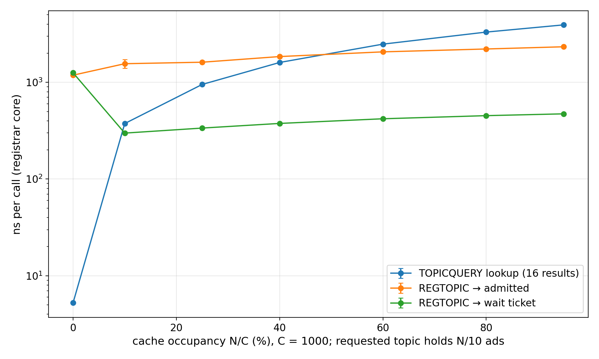
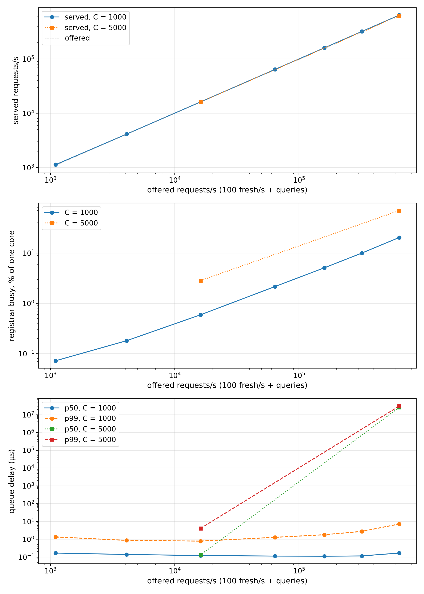
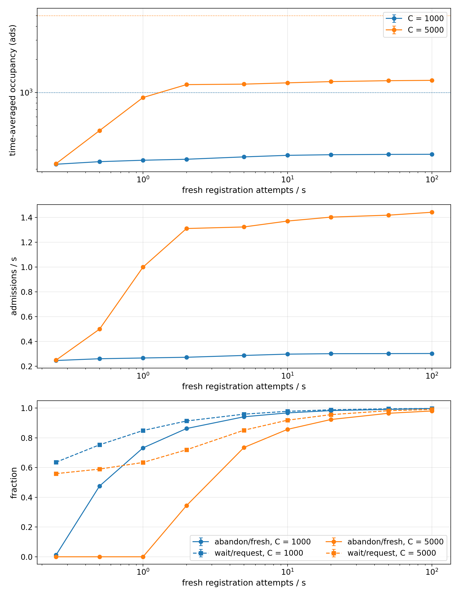

<!-- Generated by topicindex/cmd/registrarbench/study/study.py from task-3.3.4-report.md.in. Do not edit. -->
# Task 3.3.4: TopDisc registrar overhead

Report for datahop/go-ethereum#121. Full document with methods, all tables and the
validity discussion: [registrar-overhead.md](registrar-overhead.md). Every number
here is generated from the raw results by `study/regenerate.sh`.

**Scope.** We measured the cost of one TopDisc registrar in the go-ethereum
implementation (`p2p/discover/topicindex`, current `topdisc` with the fixes for the
earlier findings). The registrar core is `TopicTable`: the ad cache plus admission
control (waiting time, IP-similarity tree, lower bounds) and lookup. We measured it
with microbenchmarks, with the `REGTOPIC` validation steps (record decoding,
signature check, tickets), with simulated multi-hour runs under a population of
advertisers that behave like the production client, with controlled memory fills and
with wall-clock runs under offered load on one core (Apple M5, arm64). Network-level
behaviour, packet I/O and adversarial load are out of scope. Loads observed in the
10k-node network runs are placed on the results.

## Required results

| issue requirement | where (full document) | result |
|---|---|---|
| memory vs cache capacity / occupancy | §6.3, Figure 5 | 859 B per cached ad (typical record), 1,370 B (300-byte record); linear in occupancy |
| registration latency vs occupancy | §6.1, Figure 8 | 337 ns for a wait reply at 25% occupancy, 1,614 ns for an admission; growing slowly to 472 and 2,332 ns at 95% |
| lookup latency vs occupancy | §6.1, Figure 8 | 951 ns at 25%, 3,927 ns at 95%; linear in the topic's ad count |
| CPU utilisation vs request rate | §6.4.2, Figure 9 | registrar core busy at most 20.4% of one core in the C = 1000 sweep; 69.8% at C = 5000 when saturated |
| throughput vs offered rate | §6.4.2, Figure 9 | one core, harness included. C = 1000: knee not reached, ≥ 640,000 requests/s served in full. C = 5000: knee at or below 640,000 queries/s (620,471 served, queue delay p50 25.8 s), because lookups visit longer topic lists |
| lower-bound state vs occupancy | §6.6, Figure 7 | at most 1.00 topic and 1.52 IP bounds per cached ad |
| validation latency / cost | §6.1, validation table | full `REGTOPIC` ≈ 20,000 ns; registrar core 1.7% of it; ENR signature check 94% |
| varying capacity, occupancy, IP distribution, registration and lookup rate | §6.2, §6.5, Figure 10, Figure 4 | occupancy 22%–27% of C from 0.25 to 100 fresh attempts/s; lookup rate has no effect on admission |
| inputs from the 10k runs | §6.7 | hottest registrar ≈ 355 REGTOPIC/s, 5.3 TOPICQUERY/s → 0.72% of a core |
| pprof | §6.4.2 | CPU profile at the highest served rate; dominated by allocator and clock overhead (see below) |

## Headline numbers

* **Per request:** registrar core 372 ns + 1.88 ns per ad of
  the topic for a `REGTOPIC`; 46.6 ns per ad of the topic for a lookup.
  With validation a `REGTOPIC` costs 20,000 ns, i.e. about
  49,000 per second on one core.
* **Equilibrium:** at C = 1000 with production advertisers, 25.9% of C is
  occupied at 5 fresh attempts/s; admissions saturate at 0.30/s and the
  rest of the demand abandons (99.7% at 100 attempts/s).
* **Memory:** 1.31 MiB for a full default cache of
  maximum-size records.
* **Throughput:** at C = 1000, 640,000 requests/s served without queueing on one core (the highest rate offered, so a lower bound), with the registrar core busy 20.4% of it. At C = 5000 the worker saturates at or below 640,000 queries/s: a `TOPICQUERY` costs 1,125 ns there against 318 ns at C = 1000.

*Figure 8: Registrar-core latency per call against occupancy at C = 1000,
with the requested topic holding N/10 ads (arm64, 10 runs, mean ± 95% CI). Registrations stay below
2,332 ns; a lookup grows with the topic's ad count to 3,927 ns at 95% occupancy.*

*Figure 9: Served requests/s, registrar-core busy fraction and queue delay
against offered requests/s on one core, at C = 1000 (query sweep) and C = 5000 (two points); hybrid clock, 10 min windows,
100 fresh attempts/s, one seed. C = 1000 is served in full up to the highest rate offered;
C = 5000 saturates at 640,000 queries/s.*

*Figure 10: Occupancy, admission rate and abandoned/waiting fractions against fresh attempts/s at
C = 1000 and 5000 (production advertisers, 18 h runs, 5 seeds, mean ± 95% CI). Occupancy settles at
22%–27% of C at C = 1000; admissions saturate at
about 0.30/s and extra demand is abandoned.*

## Findings and fixes

* F1 waiting-time overflow at high occupancy: fixed by #155/#157; regression test
  `TestRegisterHighOccupancyInvariants`.
* F2 IP-tree counters drift under churn: fixed by #159; `TestIPTreeCountersMatchContents`.
  Scores still differ from the spec while the tree grows (transient).
* F3 ticket keys (6 h) expire before a 24 h quote ends: **open**.
* F4 tickets not bound to the advertiser: fixed by #160; `TestTicketNotBoundToAdvertiser`.
* F5 waiting-time deviations: G restored (#170), default C = 1000 (#182), quotes
  capped at 24 h (#155); the 0.1 factor, the service term, the 1 s floor and LAN
  scoring remain decisions for the specification (§4.2).

## Missing or provisional

* The C = 1000 knee was not reached: the sweep's highest offered rate was served in full.
* The CPU profile is dominated by overhead outside the registrar logic: span
  clearing in the allocator (40%, reached from the result slice of
  `RandomNodes`, not visible in the timed per-call cost) and clock reads
  (24%, almost all from the harness's hybrid clock). It shows that the registrar
  core is not the bottleneck, not how registrar time divides.
* 3 of the 3 registration-heavy realtime points were flagged for background
  load; their queue-delay tails (p99 262–11,010 µs) are provisional.
* The abandonment-policy sweep stopped at its deadline after 35 of
  45 runs; the no-abandonment points at 5 and 20 attempts/s were not run.
* The 10k reports give no per-registrar REGTOPIC rate as a number, no occupancy and
  no cache capacity; the registrar loads above are partly figure readings from older
  code.
* Packet decryption, session handling and response encoding are not measured; the
  registrar core plus validation is a lower bound on a full handler.
* One platform (Apple M5, macOS); the core type of the worker cannot be pinned.
